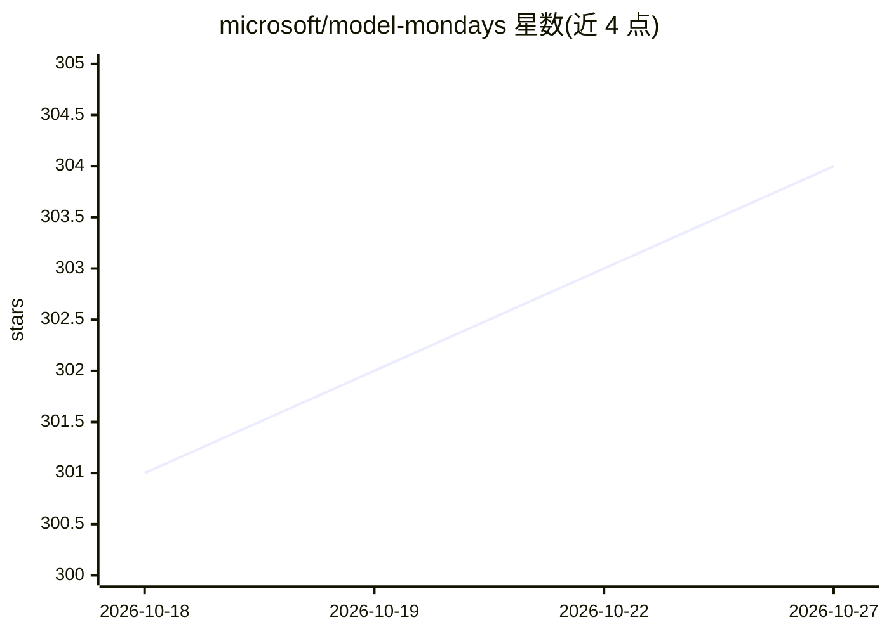

# microsoft/model-mondays

⭐ 304 · Jupyter Notebook · MIT · 推送 2026-10-07 · [GitHub](https://github.com/microsoft/model-mondays) · [官网](https://microsoft.github.io/model-mondays/) · 组织维护

**微软周更直播系列：生成式 AI 模型选型与技术聚光内容**

Model Mondays 是 Microsoft Foundry 生态下的系列直播与 AMA 活动页：每周直播涵盖模型新闻、5 分钟速览与 15 分钟模型聚光环节，另有 Foundry Fridays 专家 AMA 与面向初学者的自学课程。仓库收录 4 季节目表（主题含模型路由、微调、Agent 构建、MCP、本地 AI 等）及 YouTube 回放链接，帮助开发者了解模型能力与选型。内容以日程与链接为主，不提供可安装的软件。

## 筛选速览

| 维度 | 判定 | 备注 |
|---|---|---|
| AI 角色 | `ai-knowledge` | 知识聚合/清单类 |
| 许可风险 | `permissive` | MIT |
| 部署形态 | `None` |  |
| 模型依赖 | — | README 未给出锁定关系 |
| 硬件要求 | — | 无带数字的原话,不猜 |
| 安装摩擦 | `low` | 无编译、无系统依赖或容器化 |
| 成熟度 | — | 结构信号不足 |

## 能力要点

- 周更直播 + 5 分钟模型速览 + 15 分钟聚光环节
- Foundry Fridays 专家 AMA（独立编号，如 AMA #049）
- 面向初学者的自学课程（Models for Beginners）
- 4 季节目表覆盖模型路由、微调、Agent、MCP、本地 AI 等主题

## 适用场景

- 跟踪生成式 AI 模型动态与选型方法
- 参加专家 AMA 解答 Agent 优化问题
- 按主题索引查找往期直播回放

## 场景标签

`教程课程` · 领域:学习与行业

## 证据(README 行号)

> L13: Model Mondays is a practical livestream series for building model expertise one week at a time. Explore model capab
> L15: - **Model Mondays:** livestreams featuring model news, technical spotlights, and demos.

## 星数曲线

2026-10-18 301 → 2026-10-27 304（+3）

---
*卡片 v1 · prompt 1.4 · 生成 2026-10-21 · 置信度 high · 依据 README sha `7e11c5e3f4d3` · [字段定义](../../DATASET.md)*
