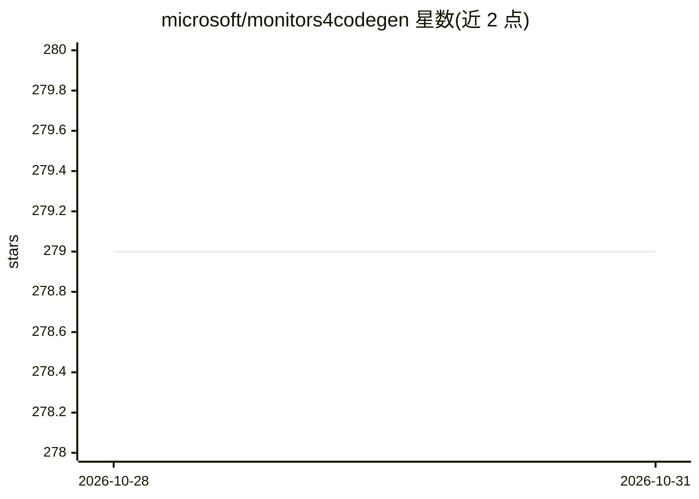

# microsoft/monitors4codegen

⭐ 279 · Python · MIT · 推送 2026-10-27 · [GitHub](https://github.com/microsoft/monitors4codegen) · [官网](https://www.microsoft.com/en-us/research/publication/guiding-language-models-of-code-with-global-context-using-monitors/) · 组织维护

**NeurIPS 2023 论文产物：静态分析引导代码 LM 解码的数据与代码**

微软维护的 NeurIPS 2023 论文 'Monitor-Guided Decoding' 官方代码与数据仓库：提供 PragmaticCode（100 个 Java 仓库）与 DotPrompts（10,538 例）两个数据集、评测脚本（计算 CR/NIM/ISM/PM 指标并复现论文图表）、18 种模型配置的推理结果（git lfs 存储），以及 MGD 监控器实现（跨 3 种语言）。论文报告 MGD 将 LM 生成代码的编译率提升 19-25%，无需训练。其中 multilspy 库已迁移至 microsoft/multilspy 仓库。运行需 Python 3.10 虚拟环境与 requirements.txt。

## 筛选速览

| 维度 | 判定 | 备注 |
|---|---|---|
| AI 角色 | `ai-ecosystem` | LLM/agent 周边工具 |
| 许可风险 | `permissive` | MIT |
| 部署形态 | `library` | 以包/库形式分发 |
| 模型依赖 | — | README 未给出锁定关系 |
| 硬件要求 | — | 无带数字的原话,不猜 |
| 安装摩擦 | `low` | 无编译、无系统依赖或容器化 |
| 成熟度 | — | 结构信号不足 |

## 能力要点

- MGD 用静态分析监控器引导 LM 解码，无需训练/微调
- PragmaticCode/DotPrompts 数据集（100 仓库、10,538 例）
- 评测脚本输出论文全部图表与 Report.md
- multilspy 语言服务器客户端库（已迁移至独立仓库）

## 适用场景

- 复现论文的评测图表与指标
- 在 DotPrompts 上评测代码 LM 的仓库级补全能力
- 研究静态分析引导解码的监控器实现

## 场景标签

`代码生成` `模型评测` · 领域:编码与开发

## 证据(README 行号)

> L5: This repository hosts the official code and data artifact for the paper "Monitor-Guided Decoding of Code LMs with St
> L12: 5. Monitor-Guided Decoding: Implementation of various monitors monitoring for different properties reported in the 
> L21: As reported in the paper, we observe that **MGD can improve the compilation rate of code generated by LMs at all sc

## 星数曲线

2026-10-28 279 → 2026-10-31 279（+0）

---
*卡片 v1 · prompt 1.4 · 生成 2026-10-28 · 置信度 mid · 依据 README sha `859714b7d10d` · [字段定义](../../DATASET.md)*
