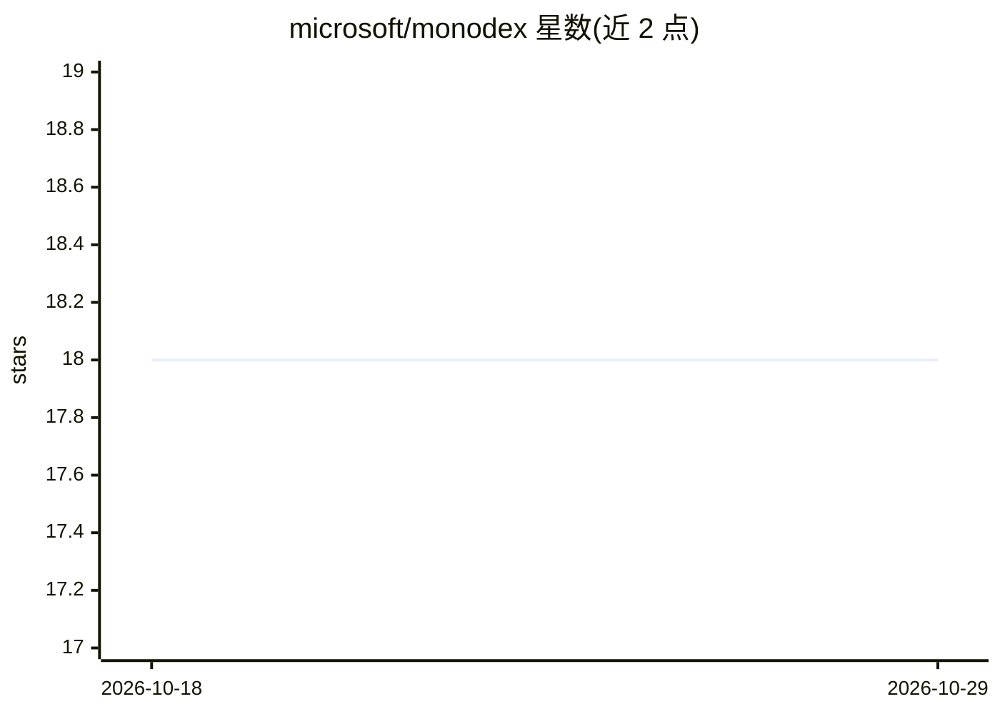

# microsoft/monodex

⭐ 18 · Rust · NOASSERTION · 推送 2026-07-30 · [GitHub](https://github.com/microsoft/monodex) · 组织维护

**面向 agent 的大型 monorepo 代码检索索引 CLI**

独立开发者工具 CLI，为大型 monorepo 提供增量索引与混合代码检索：AST 引导分块后同时构建全文检索与语义向量索引（Jina v2 code 模型，首次使用自动从 Hugging Face 下载并本地缓存），默认按 reciprocal rank 融合两类结果。CLI 输出为降低 LLM token 成本设计，供各类编码 agent shell 调用解析。索引落盘到本地 LanceDB，无外部服务、无 Docker；commit 模式从 Git 对象读取以保证可复现。当前支持 TypeScript，更多语言在计划中；MCP server 尚在 backlog。

## 筛选速览

| 维度 | 判定 | 备注 |
|---|---|---|
| AI 角色 | `ai-ecosystem` | LLM/agent 周边工具 |
| 许可风险 | `permissive` | NOASSERTION |
| 部署形态 | `library` | 以包/库形式分发 |
| 模型依赖 | — | README 未给出锁定关系 |
| 硬件要求 | — | 无带数字的原话,不猜 |
| 安装摩擦 | `medium` | 含编译或系统依赖之一 |
| 成熟度 | — | 结构信号不足 |

## 能力要点

- 全文+语义混合检索，RRF 融合，结果标注 [f]/[v]/[f+v]
- 增量索引：未变更文件跳过，可安全中断续跑
- 自包含：本地 LanceDB，无 LLM 服务/Docker/独立数据库进程
- CLI 输出面向 agent 消费，最小化 LLM token 成本

## 适用场景

- 让编码 agent 在大型 monorepo 中检索并阅读代码片段
- 按分支/commit 建立可查询的代码库快照索引
- 在不知函数名时用自然语言描述检索代码

## 场景标签

`语义搜索` · 领域:知识与检索

## 证据(README 行号)

> L12: Monodex is a standalone developer tool that provides smart, up-to-date codesearch for large monorepos. The CLI is d
> L20: - **Agent-agnostic:** CLI output crafted for agent consumption, designed to plug into a variety of coding agents an
> L47: The intended integration today is via the CLI; agents shell out to `monodex search` and `monodex view` and parse th

## 星数曲线

2026-10-18 18 → 2026-10-29 18（+0）

---
*卡片 v1 · prompt 1.4 · 生成 2026-10-29 · 置信度 high · 依据 README sha `c6bf15a0a93a` · [字段定义](../../DATASET.md)*
