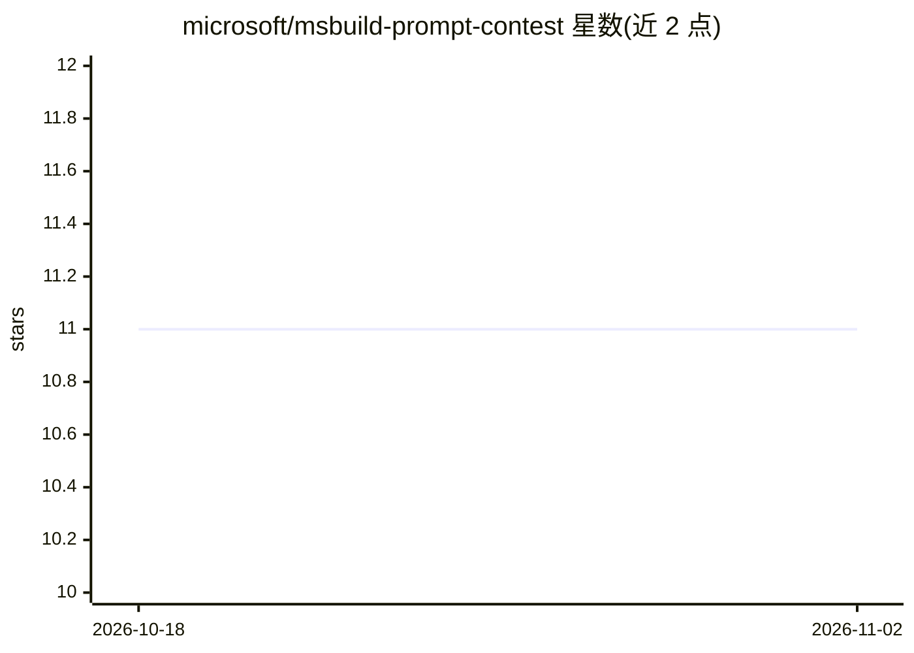

# microsoft/msbuild-prompt-contest

⭐ 11 · MIT · 推送 2026-10-27 · [GitHub](https://github.com/microsoft/msbuild-prompt-contest) · 组织维护

**Microsoft Build 2025 Agent 指令（Prompt）大赛仓库**

Microsoft 在 Build 2025 期间举办的 Best Agent Instructions 比赛专用仓库：面向撰写 agent 指令（prompt）的参赛者，说明指令的构成要素（目的、通用指南、技能）、提交方式、评审标准（创意性与适用性）与奖品（Surface 笔记本、Microsoft Store 礼品卡、数字徽章）。比赛窗口为 2025 年 5 月 19 日至 21 日，README 标注比赛已关闭。仓库不包含可运行软件，仅提供比赛信息与提示词学习资源链接。

## 筛选速览

| 维度 | 判定 | 备注 |
|---|---|---|
| AI 角色 | `ai-knowledge` | 知识聚合/清单类 |
| 许可风险 | `permissive` | MIT |
| 部署形态 | `None` |  |
| 模型依赖 | — | README 未给出锁定关系 |
| 硬件要求 | — | 无带数字的原话,不猜 |
| 安装摩擦 | `low` | 无编译、无系统依赖或容器化 |
| 成熟度 | — | 结构信号不足 |

## 能力要点

- 比赛说明：评审标准为创意性与适用性
- 列出 agent 指令三要素：Purpose、General guidelines、Skills
- 提供提示词编写的动手实验与文档链接

## 适用场景

- 了解该比赛的参赛规则与奖品设置
- 跟随其学习资源练习编写 agent 指令

## 场景标签

`提示工程` `教程课程` · 领域:Agent 开发

## 证据(README 行号)

> L4: Welcome to Microsoft's **Best Agent Instructions contest** as part of Microsoft Build 2025.
> L8: Agents are developed and become more effective as we provide instructions, knowledge, and skills. This contest focus

## 星数曲线

2026-10-18 11 → 2026-11-02 11（+0）

---
*卡片 v1 · prompt 1.4 · 生成 2026-11-02 · 置信度 mid · 依据 README sha `0e05491215bf` · [字段定义](../../DATASET.md)*
