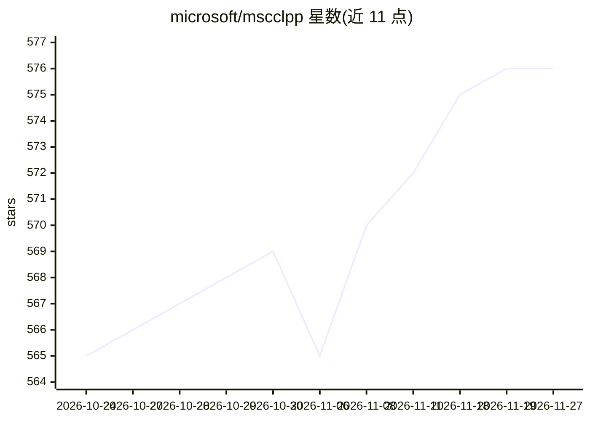

# microsoft/mscclpp

⭐ 576 · C++ · MIT · 推送 2026-11-26 · [GitHub](https://github.com/microsoft/mscclpp) · [官网](https://microsoft.github.io/mscclpp/) · 组织维护

**面向分布式 GPU 应用的 GPU 驱动通信栈**

MSCCL++ 提供跨 GPU 的底层通信抽象库，支持 CUDA、C 和 Python 接口，面向分布式 AI 应用中的集合通信与点对点数据传输。核心机制包括：多层轻量抽象（可在 GPU kernel 内实现 AllReduce 等逻辑）、单边零拷贝的同步/异步原语（put/get/signal/flush/wait）、对 NVLink/xGMI 与 InfiniBand 的统一接口，以及 PortChannel/MemoryChannel 两类通道与可自定义的主机侧代理。README 未给出安装命令，需配合 CUDA/ROCm 构建运行。

## 筛选速览

| 维度 | 判定 | 备注 |
|---|---|---|
| AI 角色 | `ai-ecosystem` | LLM/agent 周边工具 |
| 许可风险 | `permissive` | MIT |
| 部署形态 | `None` |  |
| 模型依赖 | — | README 未给出锁定关系 |
| 硬件要求 | — | 无带数字的原话,不猜 |
| 安装摩擦 | `medium` | 含编译或系统依赖之一 |
| 成熟度 | — | 结构信号不足 |

## 能力要点

- 多层轻量抽象：在 GPU kernel 内实现集合通信逻辑，Python 侧构建后传入 CUDA kernel
- 单边零拷贝同步/异步原语：put/get/signal/flush/wait，无需中间缓冲区
- 统一抽象覆盖本地/远程 GPU 与 NVLink/xGMI/InfiniBand 链路
- 提供 Python 绑定与可自定义的主机侧通信代理

## 适用场景

- LLM 张量并行推理中的 AllReduce 通信优化
- 为分布式 GPU 应用实现自定义集合通信算法
- 在 GPU kernel 中实现通信与计算重叠
- 异构互连（NVLink/InfiniBand）环境下的 GPU 间数据传输

## 场景标签

 · 领域:AI 基础设施/分布式通信

## 证据(README 行号)

> L17: A GPU-driven communication stack for scalable AI applications.
> L27: MSCCL++ redefines inter-GPU communication interfaces, thereby delivering a highly efficient and customizable commun
> L35: * **Light-weight and multi-layer abstractions.** MSCCL++ provides communication abstractions at lowest level close 

## 星数曲线

2026-10-24 565 → 2026-11-27 576（+11）

---
*卡片 v1 · prompt 1.4 · 生成 2026-11-25 · 置信度 high · 依据 README sha `b670e7d76920` · [字段定义](../../DATASET.md)*
