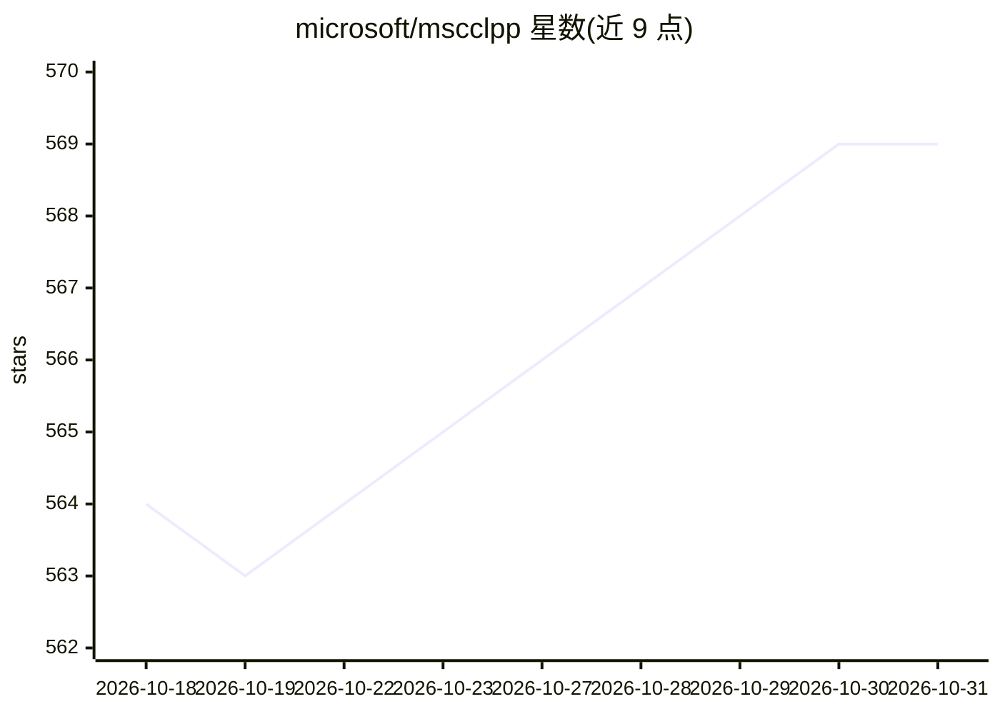

# microsoft/mscclpp

⭐ 569 · C++ · MIT · 推送 2026-10-30 · [GitHub](https://github.com/microsoft/mscclpp) · [官网](https://microsoft.github.io/mscclpp/) · 组织维护

**面向分布式 GPU 应用的 GPU 驱动通信栈**

微软维护的 C++/CUDA 通信库，提供多层通信抽象：GPU kernel 内可调用的 device 函数接口（put/get/signal/flush/wait）、1-sided 0-copy 同步与异步原语、PortChannel 与 MemoryChannel 两类通道，以及对 NVLink/xGMI/InfiniBand 的统一抽象。面向做分布式训练与 LLM 推理（张量并行）性能优化的开发者，附 Python 绑定。README 给出与 NCCL 2.19.3 的 AllReduce 吞吐对比，ARK、FlashInfer、SGLang、TVM 等项目在使用。需从源码构建，依赖 CUDA/ROCm 环境。

## 筛选速览

| 维度 | 判定 | 备注 |
|---|---|---|
| AI 角色 | `ai-ecosystem` | LLM/agent 周边工具 |
| 许可风险 | `permissive` | MIT |
| 部署形态 | `None` |  |
| 模型依赖 | — | README 未给出锁定关系 |
| 硬件要求 | — | 无带数字的原话,不猜 |
| 安装摩擦 | `medium` | 含编译或系统依赖之一 |
| 成熟度 | — | 结构信号不足 |

## 能力要点

- GPU kernel 内直接调用的 put/get/signal/flush/wait 通信原语
- 1-sided 0-copy 通信，无需远端发出接收指令
- NVLink/xGMI/InfiniBand 跨节点统一抽象
- 提供 Python 绑定与可自定义 host 侧通信 proxy

## 适用场景

- 优化 LLM 推理中张量并行的 AllReduce 通信
- 在 CUDA kernel 内实现自定义集合通信算法
- 重叠通信与计算、实现低延迟跨 GPU 数据传输

## 场景标签

`推理引擎` `模型训练` · 领域:训练与推理

## 证据(README 行号)

> L17: A GPU-driven communication stack for scalable AI applications.
> L27: MSCCL++ redefines inter-GPU communication interfaces, thereby delivering a highly efficient and customizable commun
> L45: The key motivation behind these results is scaling of inference for LLM models using tensor parallelism. LLM reques

## 星数曲线

2026-10-18 564 → 2026-10-31 569（+5）

---
*卡片 v1 · prompt 1.4 · 生成 2026-10-21 · 置信度 high · 依据 README sha `0031d07982f8` · [字段定义](../../DATASET.md)*
