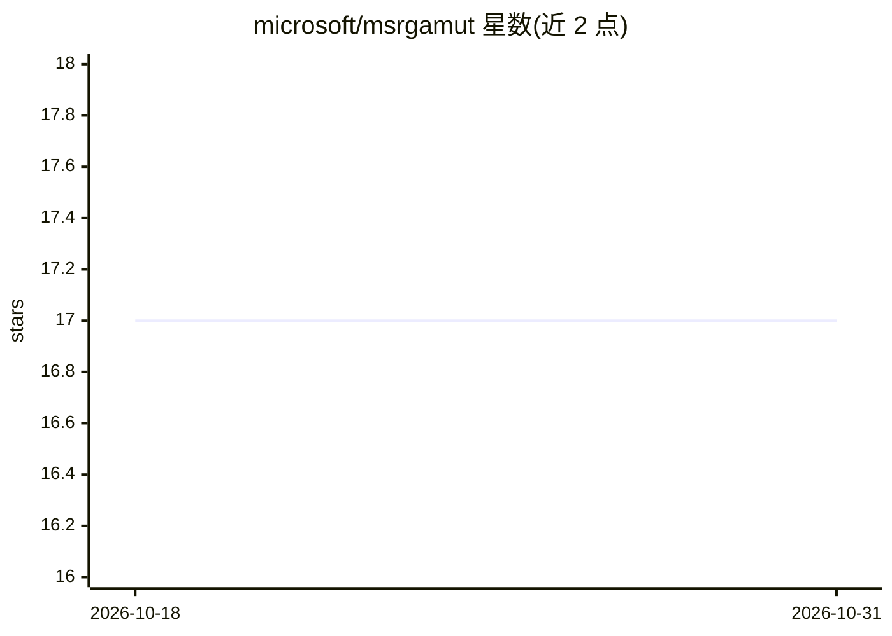

# microsoft/msrgamut

⭐ 17 · TypeScript · MIT · 推送 2026-10-21 · [GitHub](https://github.com/microsoft/msrgamut) · [官网](https://microsoft.github.io/msrgamut/) · 组织维护

**交互式可视化广义可加模型（GAM）以理解机器学习模型的原型工具**

Microsoft 发布的设计探针（design probe）原型，用于研究数据科学家如何理解机器学习模型：基于 React、D3、MobX 和 TypeScript 构建，为广义可加模型（GAM）创建交互式查看器，内置多个公开数据集（Ames Housing、Boston Housing、PIMA、Diamonds、Income、Heart-disease、Red Wine Quality、Yacht Hydrodynamics、Titanic）上构建的 GAM。通过 npm 安装并启动运行，SIGCHI 2019 论文与在线演示见 README 链接。

## 筛选速览

| 维度 | 判定 | 备注 |
|---|---|---|
| AI 角色 | `ai-ecosystem` | LLM/agent 周边工具 |
| 许可风险 | `permissive` | MIT |
| 部署形态 | `library` | 以包/库形式分发 |
| 模型依赖 | — | README 未给出锁定关系 |
| 硬件要求 | — | 无带数字的原话,不猜 |
| 安装摩擦 | `low` | 无编译、无系统依赖或容器化 |
| 成熟度 | — | 结构信号不足 |

## 能力要点

- 基于 React/D3/MobX/TypeScript 的 GAM 交互式查看器
- 内置多个公开数据集上构建的 GAM 演示
- 配有 SIGCHI 2019 论文与在线原型演示

## 适用场景

- 交互式查看 GAM 各特征形状函数以理解模型
- 研究数据科学家如何理解机器学习模型
- 教学演示 GAM 在公开数据集上的应用

## 场景标签

 · 领域:机器学习可解释性/可视化

## 证据(README 行号)

> L1: # GAMut Interactively Visualization Generalized Additive Models for Model Understanding
> L11: This code is based on react, d3, mobx, and typescript. It creates an interactive viewer of the system.
> L22: The GAMut demonstration includes GAM (General Additive Models) built from several publicly available datasets:

## 星数曲线

2026-10-18 17 → 2026-10-31 17（+0）

---
*卡片 v1 · prompt 1.4 · 生成 2026-10-29 · 置信度 high · 依据 README sha `3032736caac8` · [字段定义](../../DATASET.md)*
