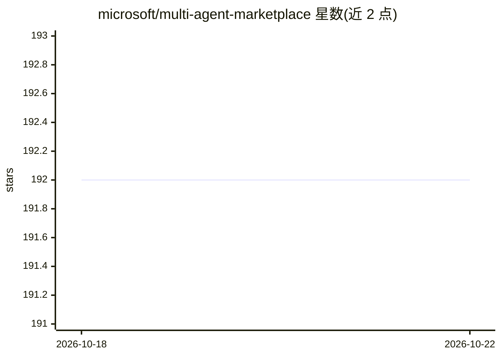

# microsoft/multi-agent-marketplace

⭐ 192 · Python · MIT · 推送 2026-10-19 · [GitHub](https://github.com/microsoft/multi-agent-marketplace) · [官网](https://microsoft.github.io/multi-agent-marketplace/) · 组织维护

**模拟 LLM 买家/卖家 agent 市场的 Python 框架**

微软开源的 Python 框架，用于模拟由 LLM 驱动的 agent 市场：配置基于 LLM 的买家与卖家 agent，运行市场仿真，并度量福利、公平性与效率等经济结果。支持对比不同模型（OpenAI、Claude、Gemini、本地模型）作为市场 agent 的表现，测试搜索算法、通信协议与市场规则，度量福利结果、识别偏见。通过 git clone 安装，提供 run/analyze CLI 与 Python 脚本接口，附 arXiv 论文。

## 筛选速览

| 维度 | 判定 | 备注 |
|---|---|---|
| AI 角色 | `ai-ecosystem` | LLM/agent 周边工具 |
| 许可风险 | `permissive` | MIT |
| 部署形态 | `None` |  |
| 模型依赖 | — | README 未给出锁定关系 |
| 硬件要求 | — | 无带数字的原话,不猜 |
| 安装摩擦 | `low` | 无编译、无系统依赖或容器化 |
| 成熟度 | — | 结构信号不足 |

## 能力要点

- 配置 LLM 驱动的买家/卖家 agent 运行市场仿真
- 度量福利、公平性、效率等经济结果
- 可对比 OpenAI/Claude/Gemini/本地模型作为市场 agent 的表现
- 提供 CLI（run/analyze）与 Python 脚本两种实验方式

## 适用场景

- 评测不同 LLM 在市场交易 agent 场景下的表现
- 实验不同的搜索算法、通信协议与市场规则
- 研究 agent 行为的福利结果与偏见、抗操纵性

## 场景标签

`多智能体` · 领域:Agent 开发

## 证据(README 行号)

> L5: **Magentic Marketplace** is a Python framework for simulating AI-powered markets. Configure LLM-based buyer and sell
> L12: - **Evaluate LLM models** - Compare how different models (OpenAI, Claude, Gemini, local models) perform as marketpl
> L13: - **Test market designs** - Experiment with different search algorithms, communication protocols, and marketplace r

## 星数曲线

2026-10-18 192 → 2026-10-22 192（+0）

---
*卡片 v1 · prompt 1.4 · 生成 2026-10-22 · 置信度 high · 依据 README sha `7922655be5d4` · [字段定义](../../DATASET.md)*
