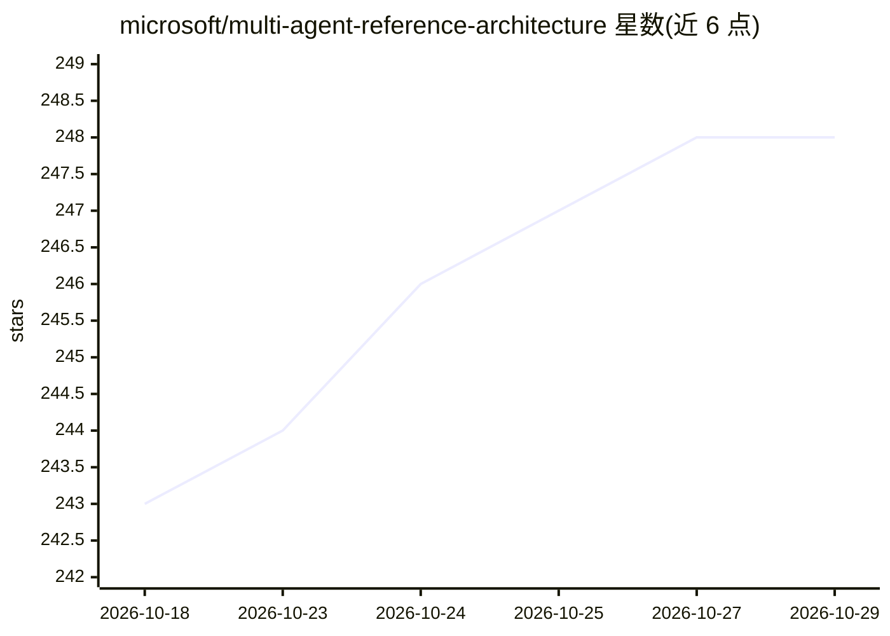

# microsoft/multi-agent-reference-architecture

⭐ 248 · Python · MIT · 推送 2026-10-27 · [GitHub](https://github.com/microsoft/multi-agent-reference-architecture) · [官网](https://aka.ms/multi-agent-system) · 组织维护

**企业多智能体系统设计的参考架构指南**

微软维护的概念性架构指南，配以实践资源，面向编排、治理和扩展多个专用智能体协作的系统设计问题，而非构建单个智能体。内容覆盖构建块、设计选项、智能体注册表、记忆、通信、可观测性、评估、安全与治理等章节，基于与微软客户合作的生产级方案整理，宣称既有立场性又保持技术栈无关。目标读者为软件架构师、工程师与数据科学家。README 阶段声明生成式 AI 生态仍在快速演进，设计将持续调整。

## 筛选速览

| 维度 | 判定 | 备注 |
|---|---|---|
| AI 角色 | `ai-knowledge` | 知识聚合/清单类 |
| 许可风险 | `permissive` | MIT |
| 部署形态 | `None` |  |
| 模型依赖 | — | README 未给出锁定关系 |
| 硬件要求 | — | 无带数字的原话,不猜 |
| 安装摩擦 | `low` | 无编译、无系统依赖或容器化 |
| 成熟度 | — | 结构信号不足 |

## 能力要点

- 覆盖智能体注册表、记忆、通信、可观测性、评估、安全、治理等章节
- 基于与微软客户合作的生产级方案整理
- 定位为技术栈与框架无关的通用参考

## 适用场景

- 设计企业级多智能体系统架构
- 为既有智能体系统扩展多智能体编排
- 查阅智能体记忆、通信、治理等主题的设计建议

## 场景标签

`多智能体` `教程课程` · 领域:Agent 开发

## 证据(README 行号)

> L5: This repository presents a conceptual guide, complemented by practical
> L31: If you want to jump straight to the architecture reference, check out the

## 星数曲线

2026-10-18 243 → 2026-10-29 248（+5）

---
*卡片 v1 · prompt 1.4 · 生成 2026-10-22 · 置信度 high · 依据 README sha `b4b59dc46920` · [字段定义](../../DATASET.md)*
