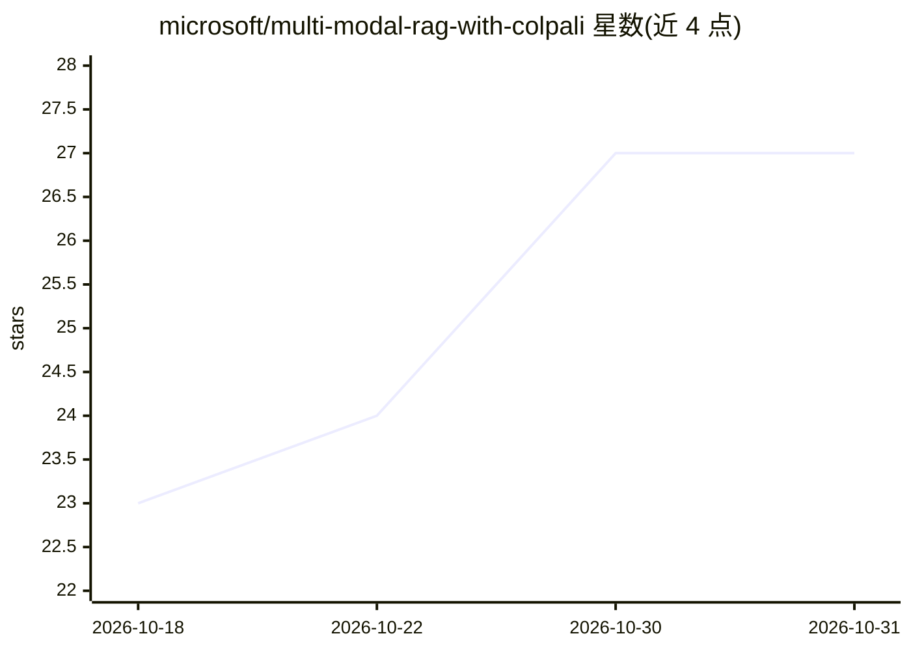

# microsoft/multi-modal-rag-with-colpali

⭐ 27 · Python · MIT · 推送 2026-10-30 · [GitHub](https://github.com/microsoft/multi-modal-rag-with-colpali) · 组织维护

**面向企业的视觉文档 RAG 部署加速器（AKS + ColPali）**

微软提供的多模态 RAG 参考实现：将文档页面作为图像处理，用量化 ColQwen3 晚期交互模型生成 token 级嵌入，经 vLLM 在 AKS GPU 节点推理，存入 Qdrant 做两级检索，再由 AI Foundry 模型基于检索页面回答。组件含事件驱动增量索引（Blob Storage → Event Grid → Service Bus）、Bicep 基础设施代码、Docker 镜像与 Helm 图表、Agent API/UI。README 明确声明非生产就绪方案，部署需 Azure 订阅与 12 GB A10 级 GPU 节点。

## 筛选速览

| 维度 | 判定 | 备注 |
|---|---|---|
| AI 角色 | `ai-ecosystem` | LLM/agent 周边工具 |
| 许可风险 | `permissive` | MIT |
| 部署形态 | `self-host` | docker 或自建部署 |
| 模型依赖 | local-ok | 支持本地模型 |
| 硬件要求 | — | 无带数字的原话,不猜 |
| 安装摩擦 | `low` | 无编译、无系统依赖或容器化 |
| 成熟度 | `idea` | |

## 能力要点

- 文档页面按图像处理，无需 OCR 与文本分块
- 量化 ColQwen3（4B/320 维）经 vLLM 推理，CPU 服务负责图像准备与池化
- 分层 token 池化 + 两级检索（均值池化候选、分层池化重排）
- 含 Bicep 基础设施代码、Docker 镜像、Helm 图表与事件驱动增量索引

## 适用场景

- 在 Azure 上部署可扩展的视觉文档问答系统
- 检索含图表、表格等版面信息的 PDF 文档
- 参考企业级多模态 RAG 的架构与调优实践

## 场景标签

`文档问答` `RAG` · 领域:知识与检索

## 证据(README 行号)

> L13: This repository provides a multi-modal RAG (Retrieval-Augmented Generation) solution that processes document pages 
> L44: This repository includes model serving, document indexing, and deployment scripts for Azure.
> L48: - Quantized ColQwen3 (`TomoroAI/tomoro-ai-colqwen3-embed-4b-awq`) inference service on AKS — vLLM GPU sidecar + CPU

## 星数曲线

2026-10-18 23 → 2026-10-31 27（+4）

---
*卡片 v1 · prompt 1.4 · 生成 2026-10-27 · 置信度 mid · 依据 README sha `4d268cf90b92` · [字段定义](../../DATASET.md)*
