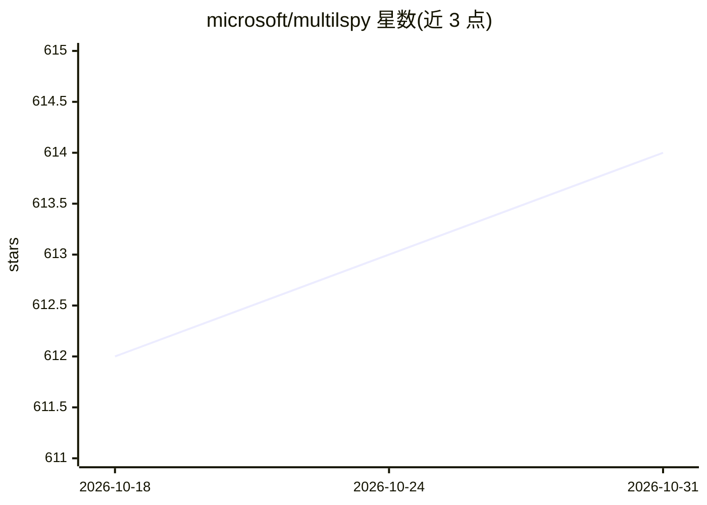

# microsoft/multilspy

⭐ 614 · Python · MIT · 推送 2026-10-29 · [GitHub](https://github.com/microsoft/multilspy) · [官网](https://www.microsoft.com/en-us/research/publication/guiding-language-models-of-code-with-global-context-using-monitors/) · 组织维护

**Python LSP 客户端库：统一接口调用多种语言服务器做静态分析**

Python 库，封装与语言服务器（LSP）交互的各步骤：自动下载平台专属 server 二进制、处理 JSON-RPC 通信、维护服务器配置，并以同步与 asyncio 两套 API 提供定义查找、引用查找、类型补全、hover 信息、文档符号列表等静态分析查询。支持 Java/Python/Rust/C# 等约 12 种语言的服务器。源自 NeurIPS 2023 论文，用于 Monitor-Guided Decoding 等场景：以静态分析结果引导 LLM 逐 token 生成代码。需 Python 3.10+，经 pip 安装。

## 筛选速览

| 维度 | 判定 | 备注 |
|---|---|---|
| AI 角色 | `ai-ecosystem` | LLM/agent 周边工具 |
| 许可风险 | `permissive` | MIT |
| 部署形态 | `library` | 以包/库形式分发 |
| 模型依赖 | — | README 未给出锁定关系 |
| 硬件要求 | — | 无带数字的原话,不猜 |
| 安装摩擦 | `low` | 无编译、无系统依赖或容器化 |
| 成熟度 | — | 结构信号不足 |

## 能力要点

- 自动下载语言服务器二进制并管理其生命周期
- 同步与 asyncio 双 API 提供定义/引用/补全/hover 等查询
- 统一接口支持约 12 种语言的语言服务器
- 用于 Monitor-Guided Decoding 等代码 LLM 引导场景

## 适用场景

- 构建查询代码静态分析的工具集
- 用类型补全等结果引导 LLM 生成可编译代码
- 获取仓库级上下文供代码 agent 使用

## 场景标签

 · 领域:开发工具/静态分析

## 证据(README 行号)

> L5: This repository hosts `multilspy`, a library developed as part of research conducted for NeruIPS 2023 paper titled "
> L7: `multilspy` is a cross-platform library designed to simplify the process of creating language server clients to quer
> L78: `multilspy` provides all the features that language-server-protocol provides to IDEs like VSCode. It is useful to d

## 星数曲线

2026-10-18 612 → 2026-10-31 614（+2）

---
*卡片 v1 · prompt 1.4 · 生成 2026-10-21 · 置信度 high · 依据 README sha `d8bbb5517772` · [字段定义](../../DATASET.md)*
