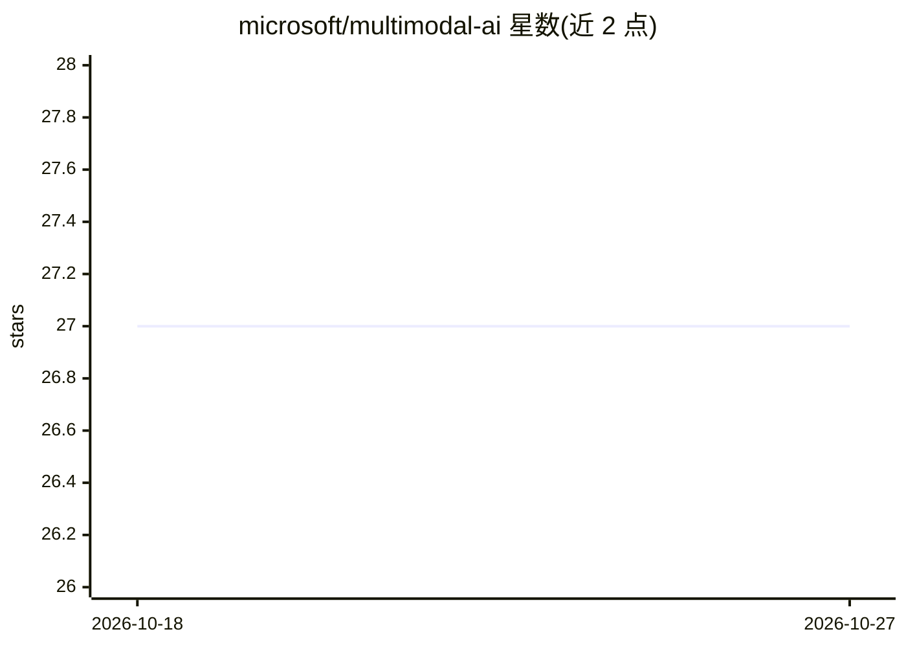

# microsoft/multimodal-ai

⭐ 27 · HCL · MIT · 推送 2026-08-25 · [GitHub](https://github.com/microsoft/multimodal-ai) · 组织维护

**微软的 Azure 多模态 GenAI 企业方案：RAG、图像/视频分析**

由微软 SWAT 团队维护的企业级多模态生成式 AI 参考方案：基于 Azure 原生 PaaS 服务（Azure OpenAI、AI Search、Document Intelligence、AI Vision 等）实现跨文本、图像、音频、视频的 RAG 与图像分类/视频分析；PDF 在索引时转图并生成多模态嵌入。采用安全默认架构（公网端点禁用、私有端点/VNet、Entra ID 认证），通过 Terraform 或 GitHub Actions 部署。当前版本仅支持 PDF 文件，音视频支持在路线图中；Bicep 实现尚未提供。

## 筛选速览

| 维度 | 判定 | 备注 |
|---|---|---|
| AI 角色 | `ai-ecosystem` | LLM/agent 周边工具 |
| 许可风险 | `permissive` | MIT |
| 部署形态 | `None` |  |
| 模型依赖 | locked-api |  |
| 硬件要求 | — | 无带数字的原话,不猜 |
| 安装摩擦 | `low` | 无编译、无系统依赖或容器化 |
| 成熟度 | — | 结构信号不足 |

## 能力要点

- 基于 Azure AI Search 集成向量化生成图像与文本嵌入
- PDF 索引时生成图像并存储于 AI Search 知识库
- 安全默认架构：私有端点/VNet 集成/Entra ID 认证/无本地认证
- 提供 Terraform 参考实现与 GitHub Actions 部署

## 适用场景

- 企业将含图表/示意图的文档接入多模态 RAG 问答
- 在自有 VNet 内以私有端点方式部署可扩展的 GenAI 方案
- 对文档图像内容做嵌入检索而非仅 OCR

## 场景标签

`RAG` `多模态` · 领域:知识与检索

## 证据(README 行号)

> L9: The goal of the Multimodal AI project is to provide an enterprise-ready solution for customers looking to infuse Gen
> L17: This project aims to provide a GenAI solution that enables customers to interact with their data across various for

## 星数曲线

2026-10-18 27 → 2026-10-27 27（+0）

---
*卡片 v1 · prompt 1.4 · 生成 2026-10-26 · 置信度 high · 依据 README sha `d1720e0ccb61` · [字段定义](../../DATASET.md)*
