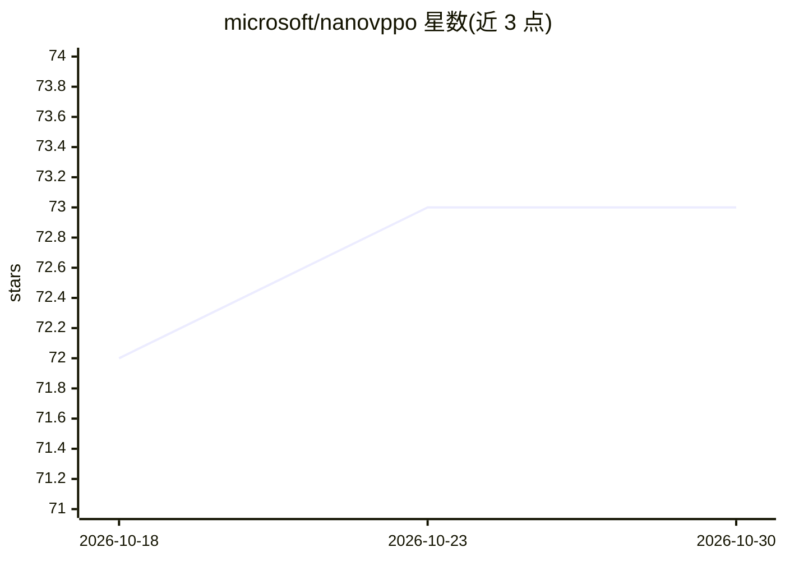

# microsoft/nanovppo

⭐ 73 · Python · MIT · 推送 2026-10-28 · [GitHub](https://github.com/microsoft/nanovppo) · 组织维护

**面向教学的 LLM 强化学习训练最小代码库：复现 GRPO/VPPO/RFT**

微软发布的精简训练代码库，用于复现 GRPO、VPPO、RFT 三种 LLM 强化学习/微调算法，定位为教学与研究工具。依赖 SGLang 与 vLLM 加速 rollout，支持单机多 GPU 训练。提供 MATH 数据集上的微调示例脚本，示例配置在单张 A100-40GB 上运行 Qwen-2.5-3B-Instruct 训练。README 声明不适合训练大规模模型，不适用于商业或高风险场景，仅以英文设计与测试。

## 筛选速览

| 维度 | 判定 | 备注 |
|---|---|---|
| AI 角色 | `ai-ecosystem` | LLM/agent 周边工具 |
| 许可风险 | `permissive` | MIT |
| 部署形态 | `None` |  |
| 模型依赖 | local-ok | 支持本地模型 |
| 硬件要求 | — | 无带数字的原话,不猜 |
| 安装摩擦 | `low` | 无编译、无系统依赖或容器化 |
| 成熟度 | — | 结构信号不足 |

## 能力要点

- 复现 GRPO、VPPO、RFT 三种算法的自包含、低依赖代码库
- 依赖 SGLang 与 vLLM 加速模型 rollout
- 支持单节点多 GPU 训练，可扩展到多节点
- 提供 MATH 数据集微调示例脚本（scripts/*.sh）

## 适用场景

- 快速上手并实验 LLM 的 RL 训练算法
- 在 MATH 数据集上复现 GRPO/VPPO/RFT 训练
- 教学场景下理解 RL 训练实现细节

## 场景标签

`强化学习` `微调` `教程课程` · 领域:学习与行业

## 证据(README 行号)

> L3: nanovvpo is a minimal codebase to reproduce RL algorithms for LLMs such as GRPO, VPPO and RFT.
> L11: nanovppo was developed as an educational tool for experiments with RL for LLMs. It represents a self-contained, dep
> L19: nanovvpo relies on SGLang (https://docs.sglang.ai/start/install.html), and VLLM (https://github.com/vllm-project/vl

## 星数曲线

2026-10-18 72 → 2026-10-30 73（+1）

---
*卡片 v1 · prompt 1.4 · 生成 2026-10-24 · 置信度 high · 依据 README sha `205e22bd1a1d` · [字段定义](../../DATASET.md)*
