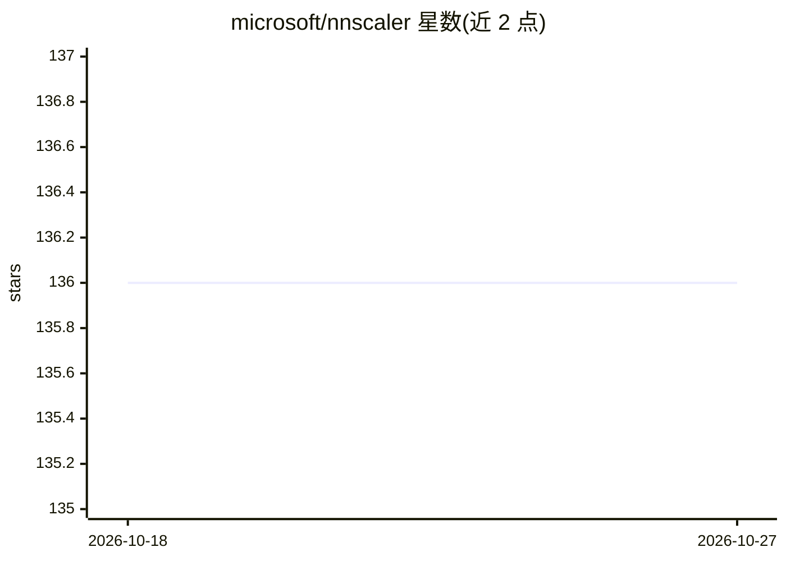

# microsoft/nnscaler

⭐ 136 · Python · MIT · 推送 2026-10-26 · [GitHub](https://github.com/microsoft/nnscaler) · [官网](https://nnscaler.readthedocs.io) · 组织维护

**把单 GPU 的 DNN/LLM 模型编译为多 GPU 并行训练程序**

微软开源的并行化引擎：读取为单 GPU 设计的 PyTorch 模型，经约束引导生成并行化方案，输出 PyTorch 代码在多 GPU/多节点上并行训练。面向两类用户：DNN 科学家只需少量代码改动即可自动并行化自有模型；系统专家可扩展新算子、探索新的并行化机制。提供 Llama-3 与 nanoGPT 示例工程，从源码 pip 安装，要求 Python 3.9-3.10 与 PyTorch 2.0-2.3，多 GPU 场景依赖 CUDA（如 flash-attn 安装）。有 OSDI'24 论文。

## 筛选速览

| 维度 | 判定 | 备注 |
|---|---|---|
| AI 角色 | `ai-ecosystem` | LLM/agent 周边工具 |
| 许可风险 | `permissive` | MIT |
| 部署形态 | `library` | 以包/库形式分发 |
| 模型依赖 | — | README 未给出锁定关系 |
| 硬件要求 | — | 无带数字的原话,不猜 |
| 安装摩擦 | `medium` | 含编译或系统依赖之一 |
| 成熟度 | — | 结构信号不足 |

## 能力要点

- 将单 GPU PyTorch 模型编译为多 GPU/多节点并行训练程序
- 并行化输出为 PyTorch 代码，便于理解与二次开发
- 提供 API 扩展新算子以支持新模型结构
- 提供 Llama-3 与 nanoGPT 端到端示例

## 适用场景

- 把我写的单 GPU LLM 训练代码扩展到多卡/多机并行
- 为长序列 LLM 训练探索新的并行化策略
- 在自有模型上以少量代码改动获得自动并行化

## 场景标签

`模型训练` · 领域:训练与推理

## 证据(README 行号)

> L7: nnScaler is a parallelization engine that compiles a Deep neural network (DNN) model that designed for single-GPU ex
> L28: For **_DNN scientists_**, they can concentrate on model design with PyTorch on single GPU, while leaving paralleliz
> L30: For **_DNN system experts_**, they can leverage nnScaler to explore new DNN parallelization mechanisms and policies

## 星数曲线

2026-10-18 136 → 2026-10-27 136（+0）

---
*卡片 v1 · prompt 1.4 · 生成 2026-10-23 · 置信度 mid · 依据 README sha `8d78b1423aae` · [字段定义](../../DATASET.md)*
