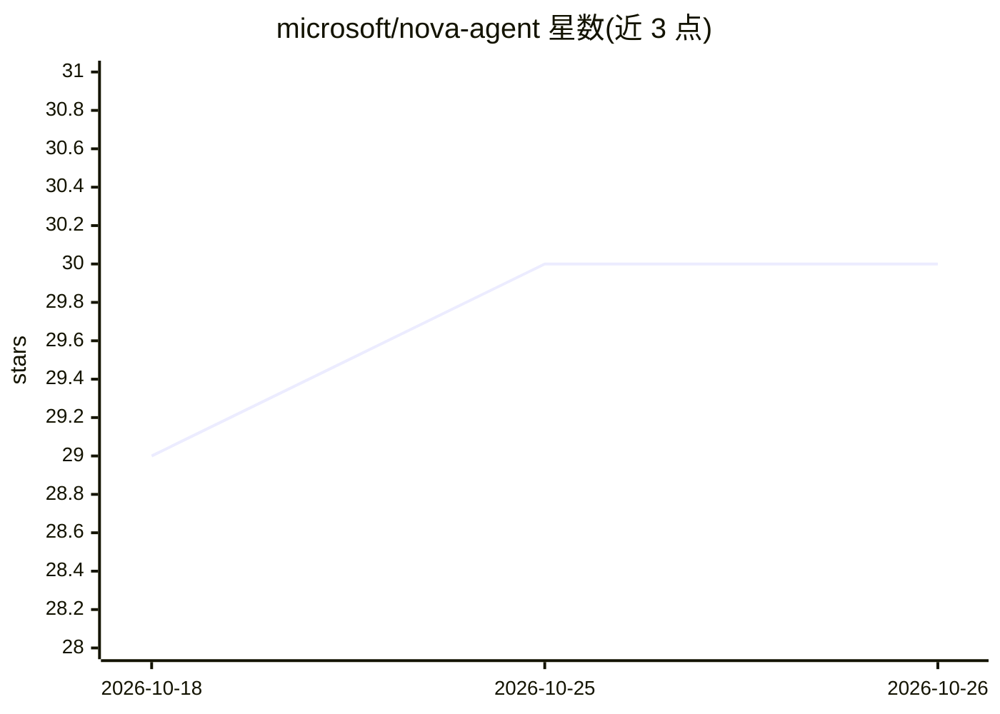

# microsoft/nova-agent

⭐ 30 · Python · MIT · 推送 2026-10-24 · [GitHub](https://github.com/microsoft/nova-agent) · 组织维护

**微软病理组化图像分析的 agentic 框架，动态生成代码调度 49 种工具**

基于 CodeAct 与 smolagents 构建的模块化 agent 框架：通过动态生成并执行 Python 代码来编排工具调用，回答用户关于可扩展计算分析的问题。内置 49 个病理领域工具（如细胞核分割、全切片编码），并可临时创建新工具。配套发布 SlideQuest 基准（90 题、四类任务）用于评测病理计算 agent。通过 git clone 加 mise/just/uv 搭建环境，配置自有 LLM API base URL 运行，提供 Gradio 交互界面与基准 runner。依赖 Hover-net 作为 git submodule 做细胞分割，存在多进程 pickle 已知问题。

## 筛选速览

| 维度 | 判定 | 备注 |
|---|---|---|
| AI 角色 | `ai-native` | 本体是模型或模型工具 |
| 许可风险 | `permissive` | MIT |
| 部署形态 | `library` | 以包/库形式分发 |
| 模型依赖 | — | README 未给出锁定关系 |
| 硬件要求 | — | 无带数字的原话,不猜 |
| 安装摩擦 | `low` | 无编译、无系统依赖或容器化 |
| 成熟度 | — | 结构信号不足 |

## 能力要点

- 基于 CodeAct/smolagents，动态生成并执行 Python 代码编排工具
- 集成 49 个病理领域工具（细胞核分割、全切片编码等），支持临时创建新工具
- 配套 SlideQuest 基准：90 题、四类任务（DataQA/CellularQA/PatchQA/SlideQA）
- 提供 Gradio 交互式探索界面

## 适用场景

- 病理学研究者用自然语言查询全切片图像并自动编排分析流程
- 在 SlideQuest 基准上评测病理计算 agent 能力
- 以 agent 方式组合细胞分割等工具做自动化实验分析

## 场景标签

`Agent 框架` `模型评测` `图像视频处理` · 领域:Agent 开发

## 证据(README 行号)

> L5: NOVA is a modular agentic framework, based on CodeAct and developed using smolagents, that dynamically generates and
> L11: To evaluate NOVA's capabilities, we introduce SlideQuest, a benchmark of 90 questions designed to evaluate computat

## 星数曲线

2026-10-18 29 → 2026-10-26 30（+1）

---
*卡片 v1 · prompt 1.4 · 生成 2026-10-26 · 置信度 mid · 依据 README sha `58720de44313` · [字段定义](../../DATASET.md)*
