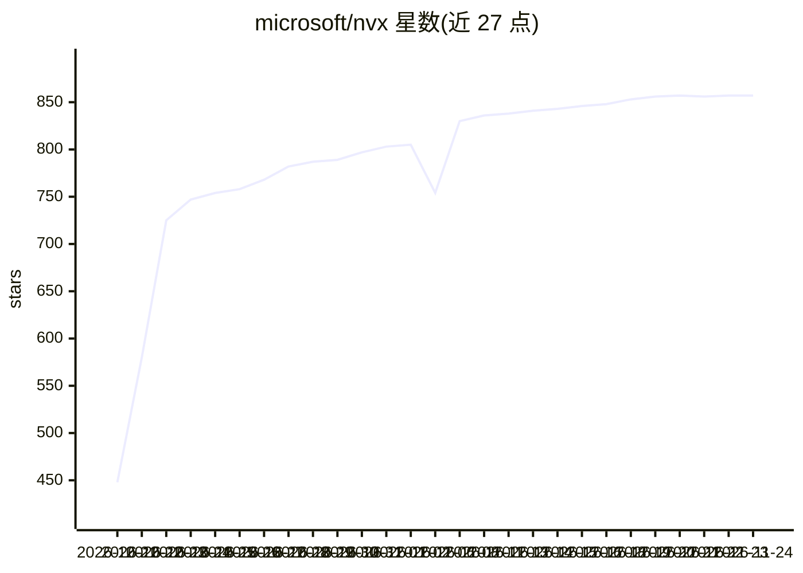

# microsoft/nvx

⭐ 865 · Rust · MIT · 推送 2026-11-24 · [GitHub](https://github.com/microsoft/nvx) · 组织维护

**面向代理工作负载的跨平台 micro-VM 沙箱**

NVX 基于 OpenVMM 构建，运行 Linux guest，提供硬件强制隔离来运行不受信任的工作负载，由 MSR 系统研究组与 Azure Research 联合开发。需 Git 与 Rust（rustup/cargo），从源码编译后在 Linux/KVM、Linux/MSHV 或 Windows/WHP 上启动 microVM，首次运行下载 CI 预构建包，guest 侧提供 Alpine、Ubuntu、Azure Linux 三种 userland 及十个静态二进制；也可通过 nvx Rust 库在自有程序中启动 microVM，或不用 Rust 直接解包运行。

## 筛选速览

| 维度 | 判定 | 备注 |
|---|---|---|
| AI 角色 | `ai-enhanced` | 去掉 AI 部分产品仍成立 |
| 许可风险 | `permissive` | MIT |
| 部署形态 | `desktop` | 安装包/桌面程序 |
| 模型依赖 | — | README 未给出锁定关系 |
| 硬件要求 | — | 无带数字的原话,不猜 |
| 安装摩擦 | `medium` | 含编译或系统依赖之一 |
| 成熟度 | — | 结构信号不足 |

## 能力要点

- 基于 OpenVMM 的 micro-VM 沙箱，硬件强制隔离运行不受信任负载
- 支持 KVM、MSHV、Windows Hypervisor Platform 三种后端
- 首次运行下载预构建包，guest 与 OpenVMM 无需构建
- 提供 nvx Rust 库供程序直接运行 microVM，并支持快照恢复/重连

## 适用场景

- 为 agent 编码/工程流程提供隔离的执行沙箱
- 在 KVM 或 Windows WHP 上以 microVM 运行不受信任代码
- 基于 nvx 库在自己的程序中启动和恢复 microVM

## 场景标签

 · 领域:系统基础设施/虚拟化沙箱

## 证据(README 行号)

> L3: NVX is an ultra-light micro-VM sandbox for running untrusted workloads with hardware-enforced
> L92: - Design - Architecture of the NVX microVM and its single-workload guest

## 星数曲线

2026-10-21 448 → 2026-11-24 857（+409）

---
*卡片 v1 · prompt 1.4 · 生成 2026-11-24 · 置信度 high · 依据 README sha `88b8563e4d77` · [字段定义](../../DATASET.md)*
