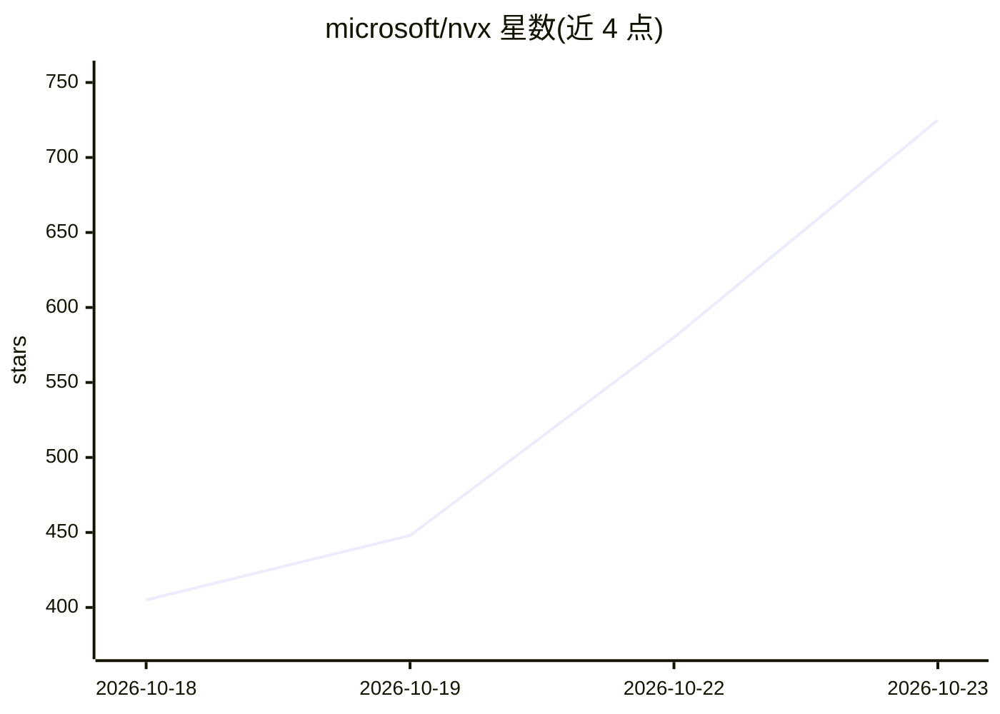

# microsoft/nvx

⭐ 725 · Rust · MIT · 推送 2026-10-22 · [GitHub](https://github.com/microsoft/nvx) · 组织维护

**面向 agent 工作负载的超轻量 micro-VM 沙箱，硬件级隔离**

微软研究院与 Azure Research Systems 联合开发的超轻量 micro-VM 沙箱，基于 OpenVMM 构建、以 Linux 为客户机，用于以硬件强制隔离方式运行不受信任的工作负载（如 agent 任务）。提供 nvx.py 运行时套件，可下载预构建包免编译，或首次用 Cargo 构建 nvx-rs；支持 Linux/KVM、Linux/MSHV 与 Windows/WHP 三种 hypervisor，附带 Alpine、Ubuntu、Azure Linux 三种客户机用户态，并有 Rust API 与基准测试工具。

## 筛选速览

| 维度 | 判定 | 备注 |
|---|---|---|
| AI 角色 | `ai-ecosystem` | LLM/agent 周边工具 |
| 许可风险 | `permissive` | MIT |
| 部署形态 | `None` |  |
| 模型依赖 | — | README 未给出锁定关系 |
| 硬件要求 | — | 无带数字的原话,不猜 |
| 安装摩擦 | `low` | 无编译、无系统依赖或容器化 |
| 成熟度 | — | 结构信号不足 |

## 能力要点

- 基于 OpenVMM 的 micro-VM，硬件强制隔离运行不受信任工作负载
- 支持 KVM / MSHV / WHP 三种 hypervisor
- 附带 Alpine、Ubuntu、Azure Linux 三种客户机用户态，九个静态客户机二进制
- 提供 nvx.py 快速启动与 Rust API（aci_edge_sandboxes / nvx crate）

## 适用场景

- 为 agent 执行不受信任代码提供隔离沙箱
- 在多平台（Linux/Windows）上快速启动轻量 micro-VM
- 对沙箱隔离机制进行基准测试与对抗性测试

## 场景标签

 · 领域:系统/虚拟化基础设施

## 证据(README 行号)

> L3: NVX is an ultra-light micro-VM sandbox for running untrusted workloads with hardware-enforced
> L18: Python 3.10 or newer and Git are required. The commands below download the prebuilt NVX package

## 星数曲线

2026-10-18 405 → 2026-10-23 725（+320）

---
*卡片 v1 · prompt 1.4 · 生成 2026-10-21 · 置信度 mid · 依据 README sha `6443167e5fd0` · [字段定义](../../DATASET.md)*
