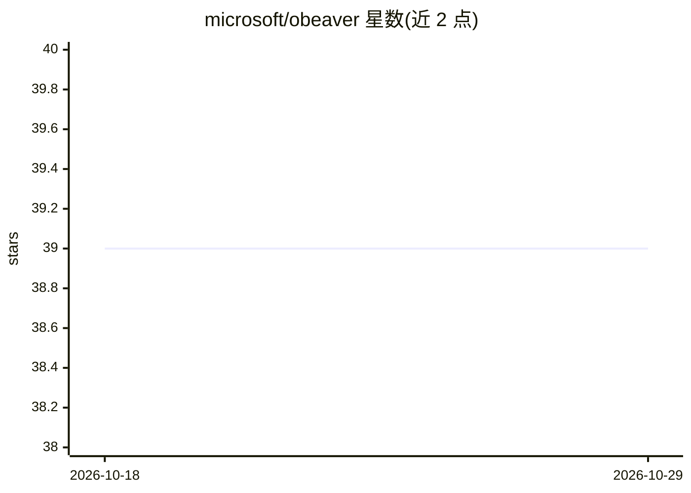

# microsoft/obeaver

⭐ 39 · HTML · MIT · 推送 2026-08-24 · [GitHub](https://github.com/microsoft/obeaver) · [官网](https://microsoft.github.io/obeaver/) · 组织维护 · 中文 README

**本地 LLM 推理工具包：OpenAI 兼容 API，数据不出本机**

面向 AI 开发者的本地优先 LLM 推理工具包，提供双推理引擎：Foundry Local（macOS/Windows 默认，自动下载模型，NPU/GPU/CPU 加速）与基于 ONNX Runtime GenAI 的 ORT（Linux 默认，完全离线）。通过 CLI 支持/serve/serve-embed 等命令提供多轮对话、OpenAI 兼容 HTTP 服务（chat/completions 与 embeddings）、函数调用、VL 视觉语言模型推理、文本嵌入与 HF 模型转 ONNX 转换，并带 Web Dashboard 展示资源占用与推理性能。需 Python 3.12+，模型转换功能标注为开发中且仅支持 CPU。

## 筛选速览

| 维度 | 判定 | 备注 |
|---|---|---|
| AI 角色 | `ai-ecosystem` | LLM/agent 周边工具 |
| 许可风险 | `permissive` | MIT |
| 部署形态 | `self-host` | docker 或自建部署 |
| 模型依赖 | — | README 未给出锁定关系 |
| 硬件要求 | — | 无带数字的原话,不猜 |
| 安装摩擦 | `low` | 无编译、无系统依赖或容器化 |
| 成熟度 | `idea` | |

## 能力要点

- 双引擎：Foundry Local 与 ORT（ONNX Runtime GenAI，完全离线）
- OpenAI 兼容 /v1/chat/completions 与 /v1/embeddings 端点
- 完整 OpenAI tools/tool_choice 函数调用支持，双引擎返回统一结构
- 内置 Web Dashboard：模型选择、内存/NPU 监控、VL 多模态界面

## 适用场景

- 让现有 OpenAI SDK 客户端零改动切换到本地推理
- 在 CI、Docker 或离线服务器上运行模型
- 为 RAG 流水线本地生成文本嵌入
- 在浏览器中测试模型并观察资源占用与推理性能

## 场景标签

`推理引擎` · 领域:训练与推理

## 证据(README 行号)

> L5: **oBeaver** is a local-first LLM inference toolkit designed for AI developers and engineers who need to run models o
> L22: - **OpenAI-compatible HTTP server** — `POST /v1/chat/completions` (streaming + non-streaming), `POST /v1/embeddings
> L19: |**Foundry Local** (default on macOS/Windows)|macOS, Windows|Powered by Microsoft Foundry Local. Automatic model do

## 星数曲线

2026-10-18 39 → 2026-10-29 39（+0）

---
*卡片 v1 · prompt 1.4 · 生成 2026-10-25 · 置信度 mid · 依据 README sha `1b8b51513b01` · [字段定义](../../DATASET.md)*
