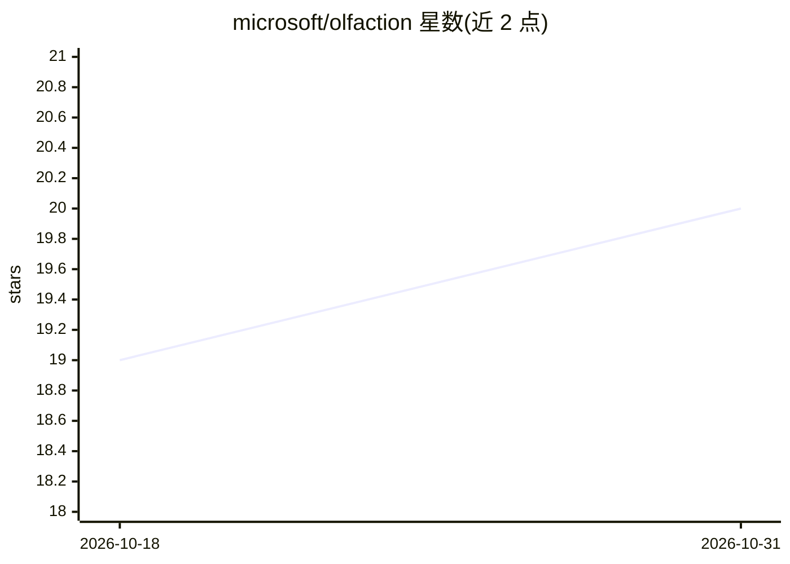

# microsoft/olfaction

⭐ 20 · Jupyter Notebook · MIT · 推送 2026-10-06 · [GitHub](https://github.com/microsoft/olfaction) · [官网](https://microsoft.github.io/olfaction/) · 组织维护

**论文代码：深度学习建模嗅觉受体与气味感知的组合编码**

微软团队发布的论文《Mapping the combinatorial coding between olfactory receptors and perception with deep learning》配套代码：包含 MolOR（气味分子-受体）与 GCN（分子-感知）模型的训练入口、消融与复现脚本、图表 notebook 及受体结合数据预处理工具。模型权重与预生成 OR 激活 logits 通过 Zenodo 与 Google Drive 分发（tar.gz 归档），环境用 conda 提供。训练依赖 ESM 蛋白嵌入需预先计算并缓存到磁盘。

## 筛选速览

| 维度 | 判定 | 备注 |
|---|---|---|
| AI 角色 | `ai-native` | 本体是模型或模型工具 |
| 许可风险 | `permissive` | MIT |
| 部署形态 | `None` |  |
| 模型依赖 | — | README 未给出锁定关系 |
| 硬件要求 | — | 无带数字的原话,不猜 |
| 安装摩擦 | `low` | 无编译、无系统依赖或容器化 |
| 成熟度 | — | 结构信号不足 |

## 能力要点

- MolOR 模型融合 ESM 残基嵌入与双向交叉注意力，支持 GCN/MPNN 分子编码器
- 受体激活数量消融脚本覆盖 HORDE、M2OR（1237 ORs）及并集
- 模型权重与预生成 logits 经 Zenodo/Google Drive 分发
- 含主文图表与统计检验（BH 校正、Jonckheere–Terpstra）notebook

## 适用场景

- 复现论文中受体-感知消融实验
- 用 MolOR 模型对 HORDE 受体序列跑激活推理
- 基于代码开展嗅觉受体与感知关系研究

## 场景标签

`模型训练` · 领域:训练与推理

## 证据(README 行号)

> L1: # Mapping the combinatorial coding between olfactory receptors and perception with deep learning
> L3: This repository contains the source code, plotting notebooks, and training data for the paper 'Mapping the combinato
> L32: - `classification_ESM.py`: trains odorant-receptor models (MolOR) with fused per-residue ESM embeddings and bidirec

## 星数曲线

2026-10-18 19 → 2026-10-31 20（+1）

---
*卡片 v1 · prompt 1.4 · 生成 2026-10-28 · 置信度 high · 依据 README sha `45c7204237ed` · [字段定义](../../DATASET.md)*
