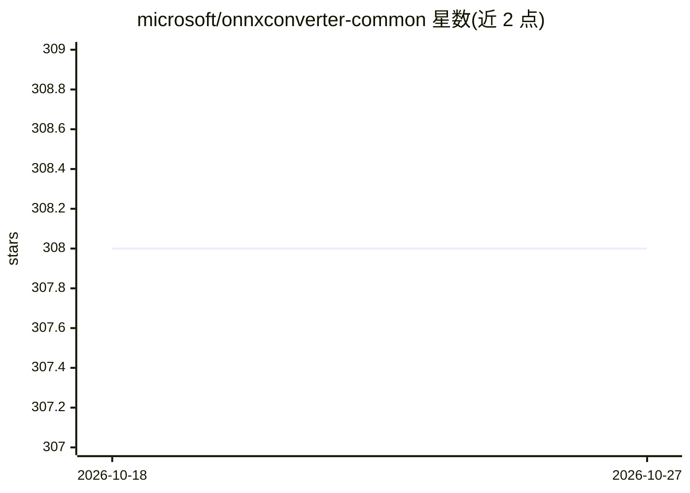

# microsoft/onnxconverter-common

⭐ 308 · Python · MIT · 推送 2026-09-01 · [GitHub](https://github.com/microsoft/onnxconverter-common) · [官网](https://pypi.org/project/onnxconverter-common) · 组织维护

**AI 框架转 ONNX 模型转换器的通用工具库**

微软维护的 Python 包 onnxconverter-common，为各类 AI 框架到 ONNX 的转换器提供通用函数与工具；支持不同转换器协同工作，将混合框架的模型（如嵌入 xgboost 模型的 scikit-learn pipeline）整体转换为 ONNX。面向编写模型转换工具的开发者，作为库被依赖使用。README 仅含简介、MIT 许可与文档链接，未给出安装命令或使用示例；仓库带 Linux/Windows 的构建状态徽章。

## 筛选速览

| 维度 | 判定 | 备注 |
|---|---|---|
| AI 角色 | `ai-ecosystem` | LLM/agent 周边工具 |
| 许可风险 | `permissive` | MIT |
| 部署形态 | `None` |  |
| 模型依赖 | — | README 未给出锁定关系 |
| 硬件要求 | — | 无带数字的原话,不猜 |
| 安装摩擦 | `low` | 无编译、无系统依赖或容器化 |
| 成熟度 | — | 结构信号不足 |

## 能力要点

- 提供各 AI 框架到 ONNX 转换器的公共函数
- 支持混合框架模型的整体转换（如 scikit-learn pipeline 内嵌 xgboost）

## 适用场景

- 开发 ONNX 模型转换器时复用公共工具函数
- 将含多个框架组件的 pipeline 转换为 ONNX

## 场景标签

 · 领域:机器学习基础设施/模型转换

## 证据(README 行号)

> L6: The onnxconverter-common package provides common functions and utilities for use in converters from various AI frame

## 星数曲线

2026-10-18 308 → 2026-10-27 308（+0）

---
*卡片 v1 · prompt 1.4 · 生成 2026-10-21 · 置信度 high · 依据 README sha `bb15826ad1e1` · [字段定义](../../DATASET.md)*
