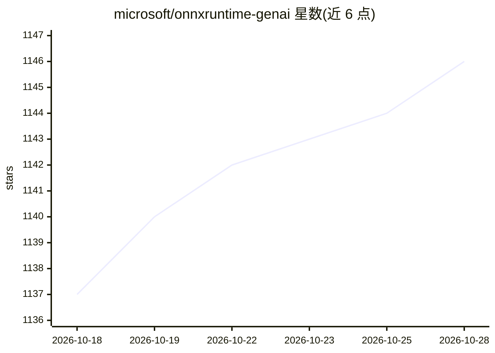

# microsoft/onnxruntime-genai

⭐ 1,147 · C++ · MIT · 推送 2026-10-28 · [GitHub](https://github.com/microsoft/onnxruntime-genai) · 组织维护

**微软的生成式 AI 推理运行时：在设备上运行 LLM**

ONNX Runtime GenAI 提供 Python/C#/C++/Java 等 API，在设备上运行生成式 AI 模型：实现生成循环的预处理、后处理、ONNX Runtime 推理、logits 处理、搜索采样、KV 缓存管理与工具调用语法规范。支持 Llama、Phi、Qwen、DeepSeek 等多种模型架构，跨 Linux/Windows/Mac/Android 系统，硬件加速覆盖 CPU/CUDA/DirectML/OpenVINO/QNN/WebGPU 等。该项目为 Foundry Local、Windows ML 与 VS Code AI Toolkit 提供支撑。Java API 需从源码构建。

## 筛选速览

| 维度 | 判定 | 备注 |
|---|---|---|
| AI 角色 | `ai-ecosystem` | LLM/agent 周边工具 |
| 许可风险 | `permissive` | MIT |
| 部署形态 | `library` | 以包/库形式分发 |
| 模型依赖 | — | README 未给出锁定关系 |
| 硬件要求 | — | 无带数字的原话,不猜 |
| 安装摩擦 | `medium` | 含编译或系统依赖之一 |
| 成熟度 | `idea` | |

## 能力要点

- 实现完整生成循环：推理、采样、KV 缓存管理、语法约束解码
- 支持 CPU/CUDA/DirectML/OpenVINO/QNN/WebGPU 等多种硬件加速
- Python/C#/C/C++/Java 多语言 API，覆盖多模型架构（Llama/Phi/Qwen/DeepSeek 等）
- 支持 Multi-LoRA 与连续解码、受限解码

## 适用场景

- 在本地设备上运行 LLM 做推理
- 为自己的应用集成跨平台的生成式 AI 推理能力
- 利用受限解码实现结构化输出与工具调用

## 场景标签

`推理引擎` · 领域:训练与推理

## 证据(README 行号)

> L11: Run generative AI models with ONNX Runtime. This API gives you an easy, flexible and performant way of running LLMs
> L13: ONNX Runtime GenAI powers Foundry Local, Windows ML, and the Visual Studio Code AI Toolkit.

## 星数曲线

2026-10-18 1,137 → 2026-10-28 1,146（+9）

---
*卡片 v1 · prompt 1.4 · 生成 2026-10-21 · 置信度 high · 依据 README sha `543c945df804` · [字段定义](../../DATASET.md)*
