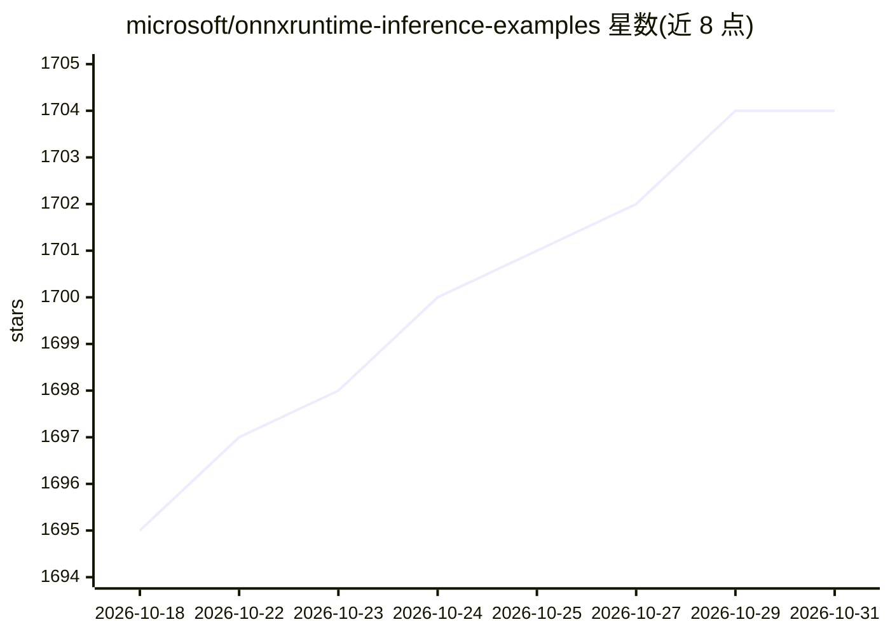

# microsoft/onnxruntime-inference-examples

⭐ 1,704 · C++ · MIT · 推送 2026-10-30 · [GitHub](https://github.com/microsoft/onnxruntime-inference-examples) · 组织维护

**微软官方 ONNX Runtime 推理示例代码集（多语言）**

微软维护的 ONNX Runtime（ORT）机器学习推理示例仓库，按类别组织：C/C++ API 示例（Linux-CPU/Windows-CPU 流水线）、移动端应用示例、JavaScript API 示例，以及针对 CPU EP 与 TensorRT EP 的量化示例。面向希望在自身项目中接入 ONNX Runtime 推理能力的开发者，作为参考代码使用。README 仅列出示例目录与贡献、商标说明，未提供统一的安装运行入口，需进入各示例目录单独查看。

## 筛选速览

| 维度 | 判定 | 备注 |
|---|---|---|
| AI 角色 | `ai-knowledge` | 知识聚合/清单类 |
| 许可风险 | `permissive` | MIT |
| 部署形态 | `None` |  |
| 模型依赖 | — | README 未给出锁定关系 |
| 硬件要求 | — | 无带数字的原话,不猜 |
| 安装摩擦 | `low` | 无编译、无系统依赖或容器化 |
| 成熟度 | — | 结构信号不足 |

## 能力要点

- 覆盖 C/C++、移动端、JavaScript 多语言 API 示例
- 包含 CPU EP 与 TensorRT EP 的量化示例
- C/C++ 示例带 Linux-CPU/Windows-CPU 流水线状态

## 适用场景

- 学习在各语言中调用 ONNX Runtime 进行推理
- 参考量化示例做 CPU/TensorRT 推理优化
- 为移动端应用集成 ONNX Runtime 查找示例

## 场景标签

`模型量化` · 领域:训练与推理

## 证据(README 行号)

> L3: This repo has examples that demonstrate the use of ONNX Runtime (ORT) for inference.
> L9: |Example|Description|Pipeline Status|

## 星数曲线

2026-10-18 1,695 → 2026-10-31 1,704（+9）

---
*卡片 v1 · prompt 1.4 · 生成 2026-10-21 · 置信度 high · 依据 README sha `247e946e820b` · [字段定义](../../DATASET.md)*
