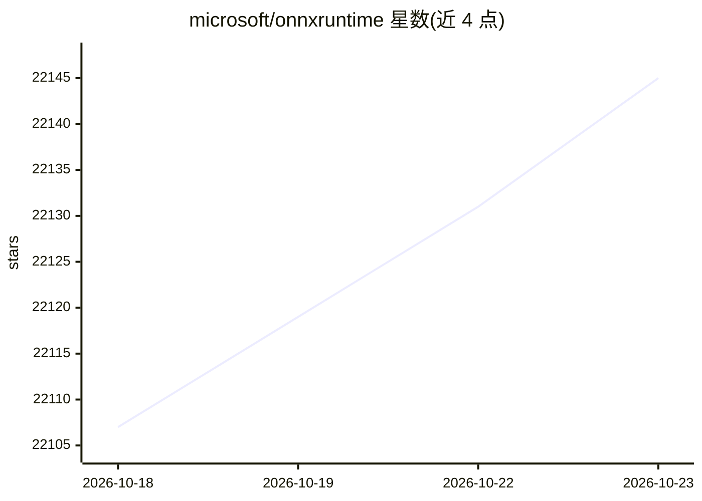

# microsoft/onnxruntime

⭐ 22,145 · C++ · MIT · 推送 2026-10-22 · [GitHub](https://github.com/microsoft/onnxruntime) · [官网](https://onnxruntime.ai) · 组织维护

**给开发者提供跨平台高性能的 ML 推理与训练加速运行时**

ONNX Runtime 是跨平台的机器学习加速运行时：推理侧可读取来自 PyTorch、TensorFlow/Keras 等深度学习框架，以及 scikit-learn、LightGBM、XGBoost 等经典机器学习库导出的模型，利用硬件加速器与图优化/变换提升性能；训练侧通过在现有 PyTorch 训练脚本中添加一行代码，加速多节点 NVIDIA GPU 上 transformer 模型的训练。以 MIT 许可发布，由微软维护，配套独立的推理与训练示例仓库及 QNN Plugin EP 插件仓库。项目可能收集使用数据并回传 Microsoft。

## 筛选速览

| 维度 | 判定 | 备注 |
|---|---|---|
| AI 角色 | `ai-ecosystem` | LLM/agent 周边工具 |
| 许可风险 | `permissive` | MIT |
| 部署形态 | `None` |  |
| 模型依赖 | — | README 未给出锁定关系 |
| 硬件要求 | — | 无带数字的原话,不猜 |
| 安装摩擦 | `low` | 无编译、无系统依赖或容器化 |
| 成熟度 | — | 结构信号不足 |

## 动量与使用信号

- 维护:`active` — 距上次 push 0.7 天,年发版 25,400 位贡献者
- 涨星:近 1 天 **+14**(自 20261016 起算)

## 能力要点

- 跨平台推理加速，支持 PyTorch/TensorFlow/Keras/scikit-learn/LightGBM/XGBoost 等来源模型
- 利用硬件加速器并结合图优化与 transforms 提供性能
- 训练侧一行代码接入现有 PyTorch 脚本，加速多节点 NVIDIA GPU 上 transformer 训练
- 提供独立的推理/训练示例仓库与 QNN Plugin EP 插件仓库

## 适用场景

- 将已训练好的深度学习或经典 ML 模型部署到多平台做推理
- 加速 transformer 模型在多节点 NVIDIA GPU 上的训练
- 在兼容的硬件加速器上运行模型以提升性能

## 场景标签

`推理引擎` `模型训练` · 领域:训练与推理

## 证据(README 行号)

> L1: **ONNX Runtime is a cross-platform inference and training machine-learning accelerator**.
> L3: **ONNX Runtime inference** can enable faster customer experiences and lower costs, supporting models from deep learn
> L5: **ONNX Runtime training** can accelerate the model training time on multi-node NVIDIA GPUs for transformer models wi

## 星数曲线

2026-10-18 22,107 → 2026-10-23 22,145（+38）

---
*卡片 v1 · prompt 1.4 · 生成 2026-10-18 · 置信度 high · 依据 README sha `547eb704fd76` · [字段定义](../../DATASET.md)*
