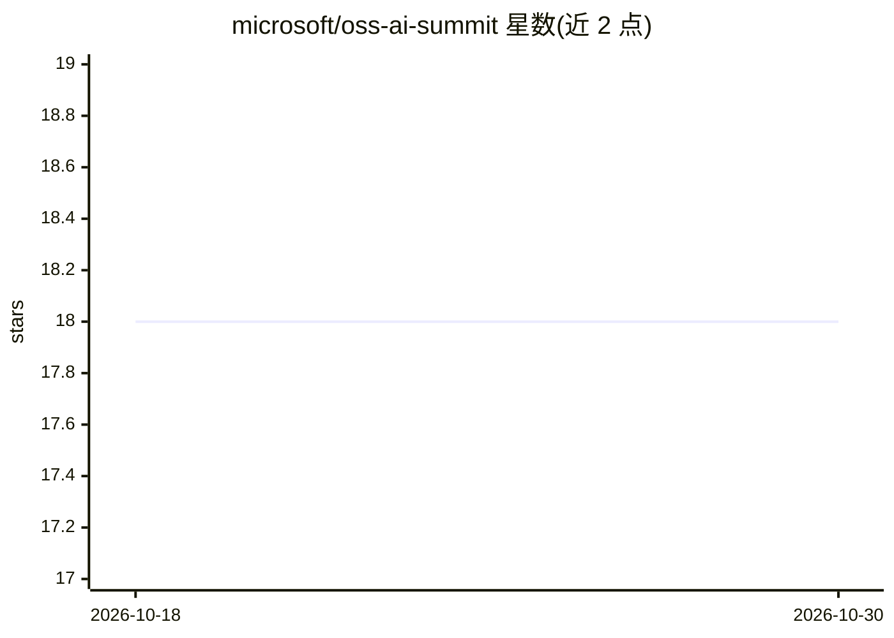

# microsoft/oss-ai-summit

⭐ 18 · TypeScript · MIT · 推送 2025-12-23 · [GitHub](https://github.com/microsoft/oss-ai-summit) · [官网](https://aka.ms/oss-ai-summit) · 组织维护

**微软主办的开源 AI 框架线上活动资源库**

由 Microsoft 维护的 OSS AI Summit 活动资源仓库：汇总系列线上活动的议程、演讲幻灯片、示例代码与录像链接，内容围绕 LangChain 等开源 AI 框架与 Azure AI 服务的结合使用，涵盖 agents、tools、MCP 多智能体工作流等主题。提供入门课程与示例工程（如 Sales Analysis Agent、Email Agent、Issue Triager Agent）的链接入口。仓库本身不含可安装运行的代码。

## 筛选速览

| 维度 | 判定 | 备注 |
|---|---|---|
| AI 角色 | `ai-knowledge` | 知识聚合/清单类 |
| 许可风险 | `permissive` | MIT |
| 部署形态 | `None` |  |
| 模型依赖 | — | README 未给出锁定关系 |
| 硬件要求 | — | 无带数字的原话,不猜 |
| 安装摩擦 | `low` | 无编译、无系统依赖或容器化 |
| 成熟度 | — | 结构信号不足 |

## 能力要点

- 汇总活动议程、幻灯片、示例代码与录像链接
- 首场活动聚焦 LangChain（Python/JavaScript）与 MCP 智能体工作流
- 提供 LangChain/LangChain.js/LangChain4j 入门课程与多个示例工程链接
- 配套 Discord 社区与 Azure AI Foundry 开发者论坛

## 适用场景

- 查找 LangChain 与 Azure AI 结合的课程和示例代码
- 回看 OSS AI Summit 各场次演讲与演示
- 了解 MCP 单/多智能体系统的实现示例

## 场景标签

`教程课程` `精选清单` · 领域:学习与行业

## 证据(README 行号)

> L4: Welcome to the OSS AI Summit! This repository hosts all resources from our series of interactive online events showc
> L19: ### Building with LangChain

## 星数曲线

2026-10-18 18 → 2026-10-30 18（+0）

---
*卡片 v1 · prompt 1.4 · 生成 2026-10-29 · 置信度 high · 依据 README sha `5b209dc44aa5` · [字段定义](../../DATASET.md)*
