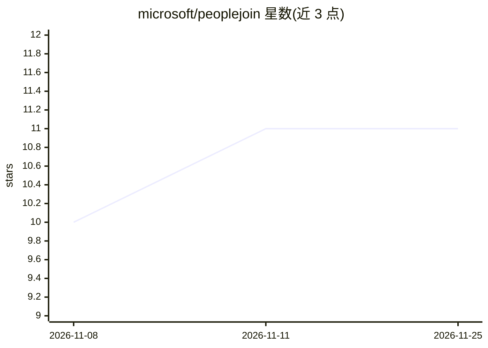

# microsoft/peoplejoin

⭐ 11 · Python · MIT · 推送 2026-02-13 · [GitHub](https://github.com/microsoft/peoplejoin) · 组织维护

**评测 LM agent 多用户协作信息收集的基准与代码数据**

PeopleJoin 是用于评测 LM 介导的协作式问题求解的基准：给定用户请求，agent 需识别潜在协作者、与其对话收集信息，并汇编答案或摘要。包含 QA（表格数据问答）与 DocCreation（文档创建）两个评测域，信息分布在 2–20 个合成用户的"组织"中。仓库提供 Python 3.11 + Poetry 的后端服务器实现、多种 LM agent 架构的实现与实验脚本，报告准确率与效率。适配自数据库问答与多文档摘要等现有 NLP 基准。

## 筛选速览

| 维度 | 判定 | 备注 |
|---|---|---|
| AI 角色 | `ai-ecosystem` | LLM/agent 周边工具 |
| 许可风险 | `permissive` | MIT |
| 部署形态 | `None` |  |
| 模型依赖 | — | README 未给出锁定关系 |
| 硬件要求 | — | 无带数字的原话,不猜 |
| 安装摩擦 | `low` | 无编译、无系统依赖或容器化 |
| 成熟度 | — | 结构信号不足 |

## 能力要点

- 两个评测域：PeopleJoin-QA（表格数据问答）与 PeopleJoin-DocCreation（文档创建）
- 信息分布于 2–20 个合成用户组织，模拟多用户协作
- 实现多种主流 LM agent 架构并报告准确率与效率
- 通过 make backend 启动本地后端服务器

## 适用场景

- 评测 LM agent 在多用户组织中的信息收集能力
- 作为数据库问答/多文档摘要场景的多用户协作改编基准
- 复现论文实验或对比不同 agent 架构的准确率与效率

## 场景标签

`模型评测` · 领域:评测与运维

## 证据(README 行号)

> L5: PEOPLEJOIN is a benchmark for evaluating LM-mediated collaborative problem solving. Given a user request, PEOPLEJOIN
> L23: 1. Run `make backend` to start a back-end server at `http://127.0.0.1:8000/`.
> L31: - Make any changes to the LLM APi interface as needed in `src/async_collab/llm/llm_client_service.py`.

## 星数曲线

2026-11-08 10 → 2026-11-25 11（+1）

---
*卡片 v1 · prompt 1.4 · 生成 2026-11-18 · 置信度 high · 依据 README sha `dc768befa852` · [字段定义](../../DATASET.md)*
