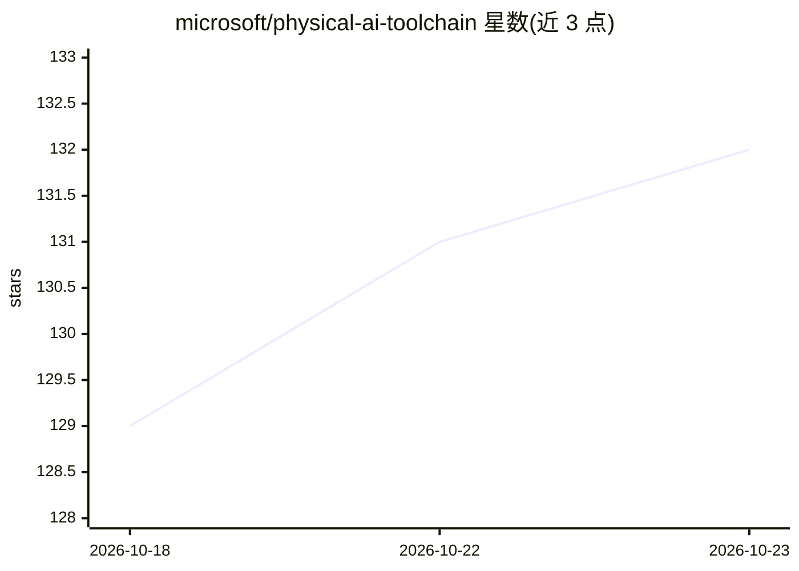

# microsoft/physical-ai-toolchain

⭐ 132 · Python · MIT · 推送 2026-10-22 · [GitHub](https://github.com/microsoft/physical-ai-toolchain) · 组织维护

**机器人/物理 AI 全生命周期工具链：采集→训练→评估→部署**

微软开源的物理 AI 与机器人开发框架，整合 Azure 云服务与 NVIDIA 物理 AI 栈（Isaac Sim/Lab、OSMO、Jetson），覆盖数据采集、ROS 到 LeRobot 数据转换、强化学习与模仿学习训练、模型评估、ONNX/TensorRT 部署与边缘推理卸载。采用 T0-T5 六级分层架构：默认 T0 路径单笔记本+单机器人即可完成闭环，无需云与 Kubernetes；T2 起引入 Azure ML 云训练，T4 起多站点机群交付。面向机器人研究人员、平台工程师与企业团队，README 声明不适用于爱好者与 ROS 初学者；T5 机群智能仍在路线图中。

## 筛选速览

| 维度 | 判定 | 备注 |
|---|---|---|
| AI 角色 | `ai-ecosystem` | LLM/agent 周边工具 |
| 许可风险 | `permissive` | MIT |
| 部署形态 | `None` |  |
| 模型依赖 | — | README 未给出锁定关系 |
| 硬件要求 | — | 无带数字的原话,不猜 |
| 安装摩擦 | `low` | 无编译、无系统依赖或容器化 |
| 成熟度 | `idea` | |

## 能力要点

- T0-T5 分层架构，默认单笔记本本地闭环（无云、无必需 Kubernetes）
- NVIDIA Isaac Sim/Lab 仿真与强化学习、OSMO 编排、Jetson 边缘推理
- Azure ML/AKS/Arc 集成，Entra ID 认证与 Terraform 基础设施即代码
- 指令驱动的 Agentic 工作流编排采集到部署全流程

## 适用场景

- 在单台笔记本与机器人上完成演示采集、模仿学习训练与验证
- 企业团队搭建带安全合规的 Jetson + Azure 生产部署
- 平台工程师用 IaC 标准化多站点机器人训练与部署流水线

## 场景标签

`强化学习` `推理引擎` `模型评测` · 领域:评测与运维

## 证据(README 行号)

> L16: **Physical AI Toolchain** is an open-source, production-ready framework that integrates Microsoft Azure cloud servi
> L90: |**Simulation & Synthetic Data**|Isaac Sim and Isaac Lab environments for RL task training and synthetic data gener
> L93: |**Training Infrastructure**|OSMO + Azure ML integration for scalable RL and IL training with experiment tracking|

## 星数曲线

2026-10-18 129 → 2026-10-23 132（+3）

---
*卡片 v1 · prompt 1.4 · 生成 2026-10-22 · 置信度 high · 依据 README sha `9d81e06ced90` · [字段定义](../../DATASET.md)*
