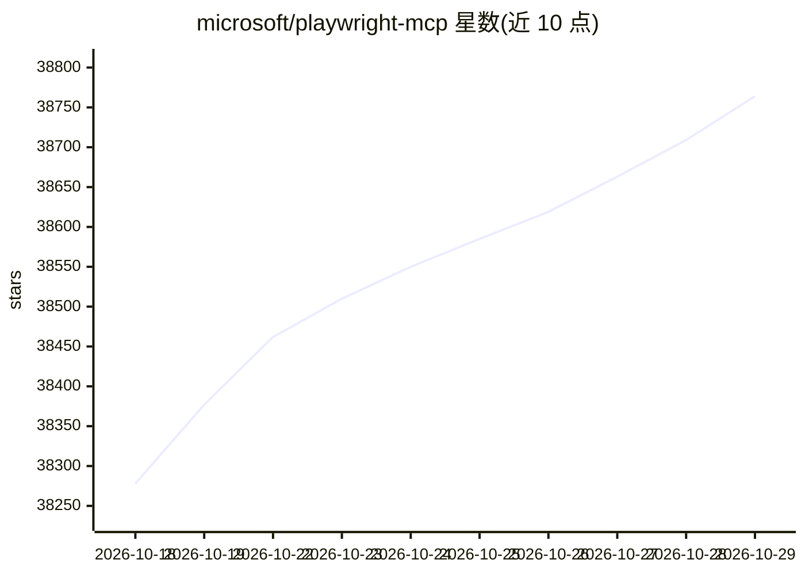

# microsoft/playwright-mcp

⭐ 38,764 · TypeScript · Apache-2.0 · 推送 2026-10-22 · [GitHub](https://github.com/microsoft/playwright-mcp) · [官网](https://www.npmjs.com/package/@playwright/mcp) · 组织维护

**给 LLM 提供浏览器自动化能力的 MCP 服务器**

基于 Playwright 的 Model Context Protocol 服务器，使 LLM 通过结构化无障碍快照与网页交互，无需截图或视觉模型。README 逐项给出 Amp、Claude Code、Codex、Cursor、Gemini CLI、Goose、VS Code、Windsurf 等约 20 种 MCP 客户端的接入配置。要求 Node.js 18 及以上，通过 npx 运行 @playwright/mcp。提供约 30 个配置参数，涵盖浏览器选择、CDP 连接、代码生成、移动设备模拟、无头模式、文件访问限制等。另提及面向编码代理的 CLI+SKILLS 替代路径。

## 筛选速览

| 维度 | 判定 | 备注 |
|---|---|---|
| AI 角色 | `ai-native` | 本体是模型或模型工具 |
| 许可风险 | `permissive` | Apache-2.0 |
| 部署形态 | `self-host` | docker 或自建部署 |
| 模型依赖 | — | README 未给出锁定关系 |
| 硬件要求 | — | 无带数字的原话,不猜 |
| 安装摩擦 | `low` | 无编译、无系统依赖或容器化 |
| 成熟度 | — | 结构信号不足 |

## 动量与使用信号

- 维护:`active` — 距上次 push 1.4 天,年发版 38,69 位贡献者
- 涨星:近 1 天 **+53**(自 20261016 起算)
- 安装:npm 包 `@playwright/mcp@latest` 月下载无数据
- 平台:WINDOWS · 协议:MCP

## 能力要点

- 基于无障碍树的结构化交互，不依赖视觉模型
- 提供 20 余种 MCP 客户端的逐步接入配置
- 约 30 个配置参数：CDP 端点、设备模拟、headless、文件访问控制等
- 支持 vision/pdf/devtools 附加能力（--caps）

## 适用场景

- 让 Claude Code、Cursor 等客户端通过 MCP 操控浏览器
- 搭建长期自主工作流中保持浏览器上下文的自动化
- 为自愈测试或探索性自动化提供页面结构推理能力

## 场景标签

`浏览器自动化` · 领域:效率与自动化

## 证据(README 行号)

> L3: A Model Context Protocol (MCP) server that provides browser automation capabilities using Playwright. This server en
> L21: - VS Code, Cursor, Windsurf, Claude Desktop, Goose, Grok, Junie or any other MCP client
> L280: Playwright MCP server supports following arguments. They can be provided in the JSON configuration above, as a par

## 星数曲线

2026-10-18 38,278 → 2026-10-29 38,764（+486）

---
*卡片 v1 · prompt 1.4 · 生成 2026-10-18 · 置信度 mid · 依据 README sha `34ec08ab1c98` · [字段定义](../../DATASET.md)*
