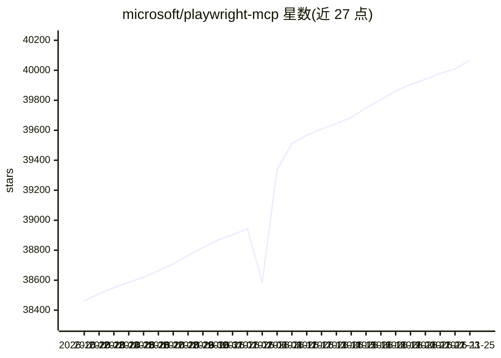

# microsoft/playwright-mcp

⭐ 40,068 · TypeScript · Apache-2.0 · 推送 2026-11-18 · [GitHub](https://github.com/microsoft/playwright-mcp) · [官网](https://www.npmjs.com/package/@playwright/mcp) · 组织维护

**给 LLM 提供浏览器自动化能力的 Playwright MCP 服务器**

基于 Playwright 的 Model Context Protocol 服务器，通过结构化可访问性快照让 LLM 与网页交互，无需截图或视觉模型。README 给出 VS Code、Cursor、Claude Desktop、Gemini CLI 等十余种 MCP 客户端的接入配置，支持浏览器选择、无头模式、CDP 连接、移动设备模拟、代码生成等参数配置。要求 Node.js 20 及以上，以 npx 方式运行。

## 筛选速览

| 维度 | 判定 | 备注 |
|---|---|---|
| AI 角色 | `ai-ecosystem` | LLM/agent 周边工具 |
| 许可风险 | `permissive` | Apache-2.0 |
| 部署形态 | `self-host` | docker 或自建部署 |
| 模型依赖 | — | README 未给出锁定关系 |
| 硬件要求 | — | 无带数字的原话,不猜 |
| 安装摩擦 | `low` | 无编译、无系统依赖或容器化 |
| 成熟度 | — | 结构信号不足 |

## 动量与使用信号

- 维护:`active` — 距上次 push 1.4 天,年发版 38,69 位贡献者
- 涨星:近 1 天 **+53**(自 20261016 起算)
- 安装:npm 包 `@playwright/mcp@latest` 月下载无数据
- 平台:WINDOWS · 协议:MCP

## 能力要点

- 基于可访问性树的结构化页面交互，不依赖视觉模型
- 支持 chrome/firefox/webkit/msedge 多浏览器与无头模式
- 支持 CDP 端点连接、移动设备模拟与多语言代码生成
- 覆盖 20+ MCP 客户端的接入配置说明

## 适用场景

- 让 MCP 客户端中的 AI 代理自动化操作网页
- 构建需要持久浏览器上下文的自主工作流
- 自愈式测试与探索性浏览器自动化

## 场景标签

`浏览器自动化` · 领域:效率与自动化

## 证据(README 行号)

> L3: A Model Context Protocol (MCP) server that provides browser automation capabilities using Playwright. This server en
> L21: - VS Code, Cursor, Windsurf, Claude Desktop, Goose, Grok, Junie or any other MCP client
> L20: - Node.js 20 or newer

## 星数曲线

2026-10-22 38,462 → 2026-11-25 40,068（+1,606）

---
*卡片 v1 · prompt 1.4 · 生成 2026-11-22 · 置信度 mid · 依据 README sha `79320c034faa` · [字段定义](../../DATASET.md)*
