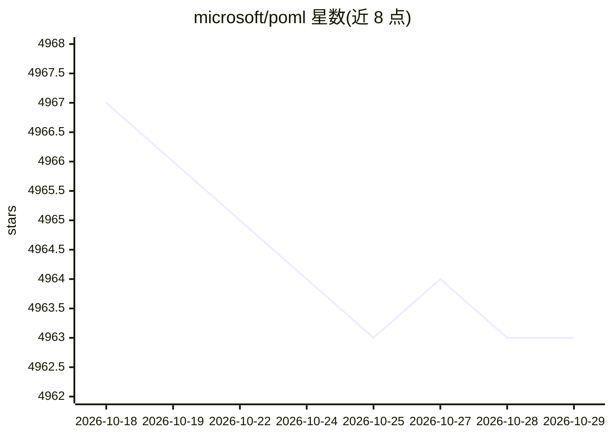

# microsoft/poml

⭐ 4,963 · TypeScript · MIT · 推送 2026-01-14 · [GitHub](https://github.com/microsoft/poml) · [官网](https://microsoft.github.io/poml/) · 组织维护

**面向 LLM 提示词工程的标记语言与配套工具链**

微软维护的提示词编排标记语言：用类 HTML 语法（<role>/<task>/<example> 等）组织提示词组件，支持嵌入文本、表格、图片等外部数据，内置模板引擎（变量/循环/条件），并用类 CSS 样式系统将内容与呈现解耦以缓解 LLM 格式敏感性。提供 VS Code 扩展（高亮、补全、实时预览、交互测试）与 Node.js/Python SDK，供开发者在应用与 LLM 框架中集成。测试前需自行配置模型、API key 与端点。

## 筛选速览

| 维度 | 判定 | 备注 |
|---|---|---|
| AI 角色 | `ai-ecosystem` | LLM/agent 周边工具 |
| 许可风险 | `permissive` | MIT |
| 部署形态 | `desktop` | 安装包/桌面程序 |
| 模型依赖 | — | README 未给出锁定关系 |
| 硬件要求 | — | 无带数字的原话,不猜 |
| 安装摩擦 | `low` | 无编译、无系统依赖或容器化 |
| 成熟度 | — | 结构信号不足 |

## 能力要点

- 类 HTML 语义组件的提示词标记语法
- 类 CSS 样式系统将内容与呈现解耦
- 内置模板引擎（变量/循环/条件/<let>）
- VS Code 扩展与 Node.js/Python 双 SDK

## 适用场景

- 以结构化标记编写和维护复杂 LLM 提示词
- 在提示词中嵌入文本、表格、图片等外部数据
- 在 VS Code 中预览、诊断并交互测试提示词

## 场景标签

`提示工程` · 领域:Agent 开发

## 证据(README 行号)

> L11: **POML (Prompt Orchestration Markup Language)** is a novel markup language designed to bring structure, maintainabi
> L19: - **Structured Prompting Markup**: Employs an HTML-like syntax with semantic components such as `<role>`, `<task>`,
> L25:  - **Software Development Kits (SDKs)**: Offers SDKs for Node.js (JavaScript/TypeScript) and Python for seamless in

## 星数曲线

2026-10-18 4,967 → 2026-10-29 4,963（-4）

---
*卡片 v1 · prompt 1.4 · 生成 2026-10-20 · 置信度 high · 依据 README sha `dc1741d8e7fa` · [字段定义](../../DATASET.md)*
