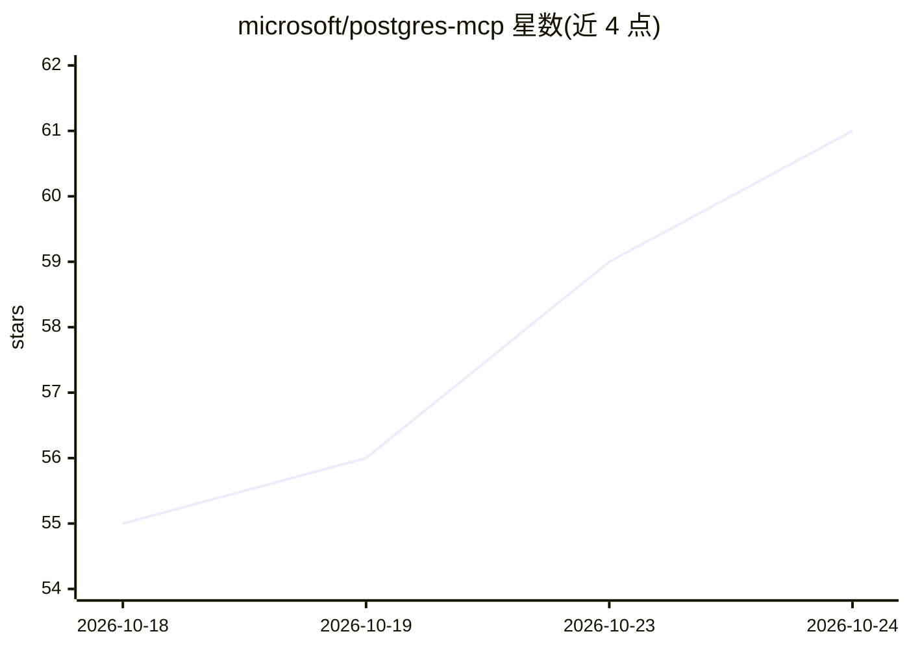

# microsoft/postgres-mcp

⭐ 63 · MIT · 推送 2026-10-23 · [GitHub](https://github.com/microsoft/postgres-mcp) · 组织维护

**让编码 agent 通过 MCP 连接 PostgreSQL 的服务器**

微软维护的 MCP 服务器，使 Claude Code、GitHub Copilot、Codex、Cursor 等编码 agent 连接 PostgreSQL，执行查询与分析、设计 schema、诊断服务器与查询性能、管理连接配置及通过 COPY 批量导入 CSV。凭证存于 OS keyring 而非配置文件；`postgres_mcp_query` 只读，写入需显式配置；支持 Azure 上 Microsoft Entra ID 认证与 TLS。运行要求 Node.js 22+，可用 npx 直接运行，Release 状态为 Preview。

## 筛选速览

| 维度 | 判定 | 备注 |
|---|---|---|
| AI 角色 | `ai-ecosystem` | LLM/agent 周边工具 |
| 许可风险 | `permissive` | MIT |
| 部署形态 | `library` | 以包/库形式分发 |
| 模型依赖 | — | README 未给出锁定关系 |
| 硬件要求 | — | 无带数字的原话,不猜 |
| 安装摩擦 | `low` | 无编译、无系统依赖或容器化 |
| 成熟度 | `idea` | |

## 能力要点

- 通过 MCP over stdio 提供查询/DDL/DML、schema 获取、CSV 批量加载与性能诊断等工具
- 连接凭证存于 OS keyring，不进入客户端配置；错误信息中自动清除机密
- 支持只读 profile 与本地文件访问路径白名单等安全机制
- 兼容本地、Docker、Azure、AWS RDS/Aurora、GCP Cloud SQL 等多种 PostgreSQL 部署

## 适用场景

- 让编码 agent 直接查询和分析我的 PostgreSQL 数据库
- 通过对话让 agent 设计表结构或导入 CSV 数据
- 让 agent 诊断 PostgreSQL 服务器与慢查询性能问题

## 场景标签

`数据分析` · 领域:效率与自动化

## 证据(README 行号)

> L7: **Connect your coding agent to PostgreSQL.** `postgres-mcp` lets you generate
> L37: The server speaks MCP over stdio. Point your client at

## 星数曲线

2026-10-18 55 → 2026-10-24 61（+6）

---
*卡片 v1 · prompt 1.4 · 生成 2026-10-24 · 置信度 high · 依据 README sha `dbbe0822e896` · [字段定义](../../DATASET.md)*
