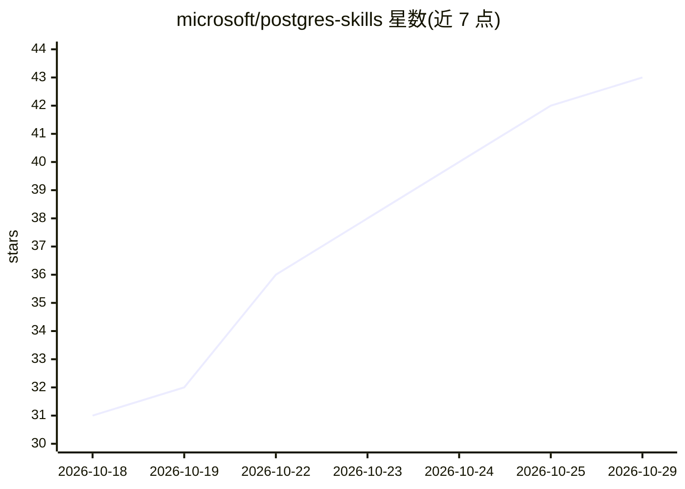

# microsoft/postgres-skills

⭐ 43 · Python · MIT · 推送 2026-10-16 · [GitHub](https://github.com/microsoft/postgres-skills) · 组织维护

**面向 AI 编码代理的 PostgreSQL 专家技能插件（33 个子技能）**

微软维护的 agent 技能/插件仓库：向 Claude Code、GitHub Copilot CLI、Codex CLI 等 AI 编码代理提供 33 个 PostgreSQL 专家子技能，覆盖开发、查询性能、索引、向量检索、RAG、安全、运维与 Apache AGE 图全生命周期；厂商中立实践加 Azure Database for PostgreSQL / HorizonDB 专属模式。配合 postgres-mcp MCP 服务器与 Azure CLI，代理可读取真实库 schema、执行查询与确认后的变更。也可经 skills.sh CLI 只安装技能本体。

## 筛选速览

| 维度 | 判定 | 备注 |
|---|---|---|
| AI 角色 | `ai-knowledge` | 知识聚合/清单类 |
| 许可风险 | `permissive` | MIT |
| 部署形态 | `library` | 以包/库形式分发 |
| 模型依赖 | — | README 未给出锁定关系 |
| 硬件要求 | — | 无带数字的原话,不猜 |
| 安装摩擦 | `low` | 无编译、无系统依赖或容器化 |
| 成熟度 | — | 结构信号不足 |

## 能力要点

- 33 个子技能：含 11 个通用基础技能、12 个 Azure 专属子技能、pg-graph 图技能
- 捆绑 postgres-mcp MCP 服务器，代理可在确认后执行数据库操作
- 支持 Claude Code / GitHub Copilot CLI / Codex CLI 三类宿主代理
- 可经 npx skills 只安装技能本体，不含 MCP 服务器

## 适用场景

- 让 AI 编码代理按专家实践帮我调优 PostgreSQL 查询与索引
- 在代理中安全执行分区、RLS、向量检索等数据库变更
- 管理 Azure Database for PostgreSQL / HorizonDB 的运维与恢复
- 在 PostgreSQL 内用 Apache AGE 构建与查询知识图谱

## 场景标签

`RAG` `知识图谱` · 领域:知识与检索

## 证据(README 行号)

> L6: **Build, tune, and operate PostgreSQL with an AI assistant that can act, not just advise.** Postgres Skills gives de
> L22: This repo is the plugin. Installing it gives your agent three things that work together:
> L24: - **The skill** — a lightweight routing table that reads your question and connection, then loads the matching sub-

## 星数曲线

2026-10-18 31 → 2026-10-29 43（+12）

---
*卡片 v1 · prompt 1.4 · 生成 2026-10-25 · 置信度 high · 依据 README sha `e0e70879bf22` · [字段定义](../../DATASET.md)*
