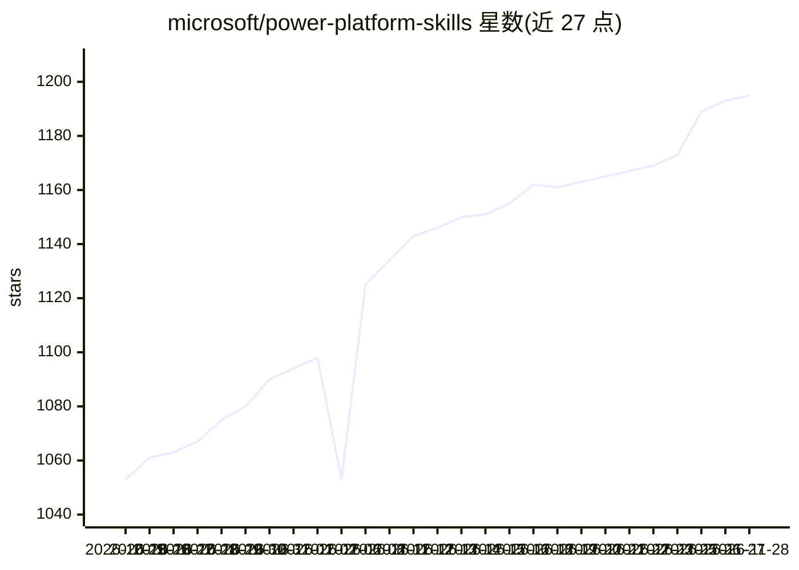

# microsoft/power-platform-skills

⭐ 1,195 · JavaScript · MIT · 推送 2026-11-27 · [GitHub](https://github.com/microsoft/power-platform-skills) · [官网](https://microsoft.github.io/power-platform-skills/) · 组织维护

**微软官方插件市场：让 AI 助手构建 Power Platform 应用**

由 Microsoft 维护的插件市场仓库，向 GitHub Copilot 与 Claude Code 等 AI 助手提供 Power Platform 开发插件，覆盖 Power Pages、模型驱动应用、Canvas 应用、Code Apps、移动应用、Power Automate、Dataverse、PCF、MCP Apps 等类别。安装方式包括一条命令的快速安装器（需 Node.js）、插件页面一键安装链接，或在助手会话内用 /plugin 命令手动添加。插件以 MIT 许可开源；使用需自备 AI 助手与 Power Platform 环境（可能需要许可证），部分插件默认向 Microsoft 发送使用数据但提供关闭命令。

## 筛选速览

| 维度 | 判定 | 备注 |
|---|---|---|
| AI 角色 | `ai-ecosystem` | LLM/agent 周边工具 |
| 许可风险 | `permissive` | MIT |
| 部署形态 | `None` |  |
| 模型依赖 | — | README 未给出锁定关系 |
| 硬件要求 | — | 无带数字的原话,不猜 |
| 安装摩擦 | `high` | 编译与系统依赖俱全 |
| 成熟度 | — | 结构信号不足 |

## 能力要点

- 一条命令将全部插件装入 Claude Code 或 GitHub Copilot CLI（需 Node.js）
- 11 类插件覆盖网站、业务应用、流程自动化、Dataverse 数据操作
- 插件含可调用的 skills（如 /app-builder、/create-site）与 report-issue 工单草拟技能
- 自动更新机制，更新与卸载有对应命令

## 适用场景

- 用自然语言让 AI 助手创建并发布 Power Pages 网站
- 从自然语言意图生成模型驱动应用的表单、视图与安全角色
- 构建、调试 Power Automate 云端流程
- 把 CSV 数据导入 Dataverse 表

## 场景标签

`代码生成` · 领域:编码与开发

## 证据(README 行号)

> L3: Plugins from Microsoft that teach AI assistants, such as GitHub Copilot and Claude Code, to build on Power Platform.
> L190: |Plugin|A package that teaches your assistant a set of jobs.|
> L192: |Marketplace|A list of plugins your assistant can install. This repository is one.|

## 星数曲线

2026-10-25 1,053 → 2026-11-28 1,195（+142）

---
*卡片 v1 · prompt 1.4 · 生成 2026-11-24 · 置信度 high · 依据 README sha `214aa7ceec49` · [字段定义](../../DATASET.md)*
