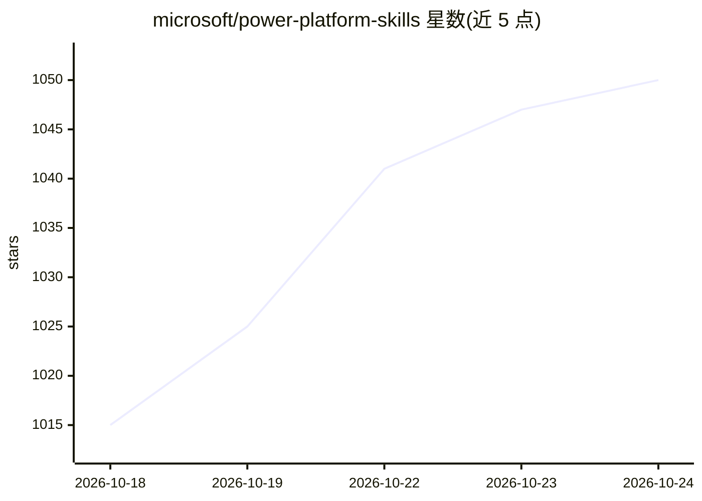

# microsoft/power-platform-skills

⭐ 1,050 · JavaScript · MIT · 推送 2026-10-23 · [GitHub](https://github.com/microsoft/power-platform-skills) · [官网](https://aka.ms/ppskills) · 组织维护

**微软官方 Power Platform 开发插件市场：给 Copilot/Claude Code 的技能集**

微软维护的插件市场（Open Plugins 清单格式），收录面向 GitHub Copilot CLI 与 Claude Code 的 Power Platform 开发插件共 10 类：Power Pages、Model Apps（自然语言生成表/窗体/应用）、PCF 代码组件、MCP Apps、Code Apps、移动应用、Canvas Apps（需 .NET 10 SDK）、Power Automate 流程调试、Process Mining 分析及外置 Dataverse 插件。提供一键 Node 安装脚本（自动装 pac CLI、注册市场、自动更新）与手动 /plugin 命令两种安装方式，支持本地开发调试与自动批准配置。部分插件声明 Preview，Process Intelligence 不支持 GCC/GCC High/DoD/Mooncake 环境。

## 筛选速览

| 维度 | 判定 | 备注 |
|---|---|---|
| AI 角色 | `ai-ecosystem` | LLM/agent 周边工具 |
| 许可风险 | `permissive` | MIT |
| 部署形态 | `None` |  |
| 模型依赖 | — | README 未给出锁定关系 |
| 硬件要求 | — | 无带数字的原话,不猜 |
| 安装摩擦 | `high` | 编译与系统依赖俱全 |
| 成熟度 | `idea` | |

## 能力要点

- 一键安装脚本自动安装 pac CLI 并注册插件市场、启用自动更新
- 覆盖 10 类 Power Platform 开发插件（Power Pages/Model Apps/PCF/MCP Apps 等）
- 兼容 GitHub Copilot CLI 与 Claude Code 双宿主，含 legacy 清单镜像
- Model Apps 支持从自然语言意图生成完整模型驱动应用

## 适用场景

- 在 Copilot/Claude Code 会话中用自然语言构建 Power Platform 应用
- 开发、部署与验证 PCF 代码组件
- 通过 FlowAgent MCP 服务端构建与调试 Power Automate 云端流
- 分析 Power Automate Process Mining 数据的瓶颈与变体

## 场景标签

 · 领域:低代码/企业应用开发工具

## 证据(README 行号)

> L7: This repository is a **plugin marketplace** containing GitHub Copilot/Claude Code plugins for Power Platform service
> L31: - Registers the plugin marketplace and installs all listed plugins except `dataverse`
> L58:     /plugin marketplace add microsoft/power-platform-skills

## 星数曲线

2026-10-18 1,015 → 2026-10-24 1,050（+35）

---
*卡片 v1 · prompt 1.4 · 生成 2026-10-21 · 置信度 high · 依据 README sha `5c4d0f35770f` · [字段定义](../../DATASET.md)*
