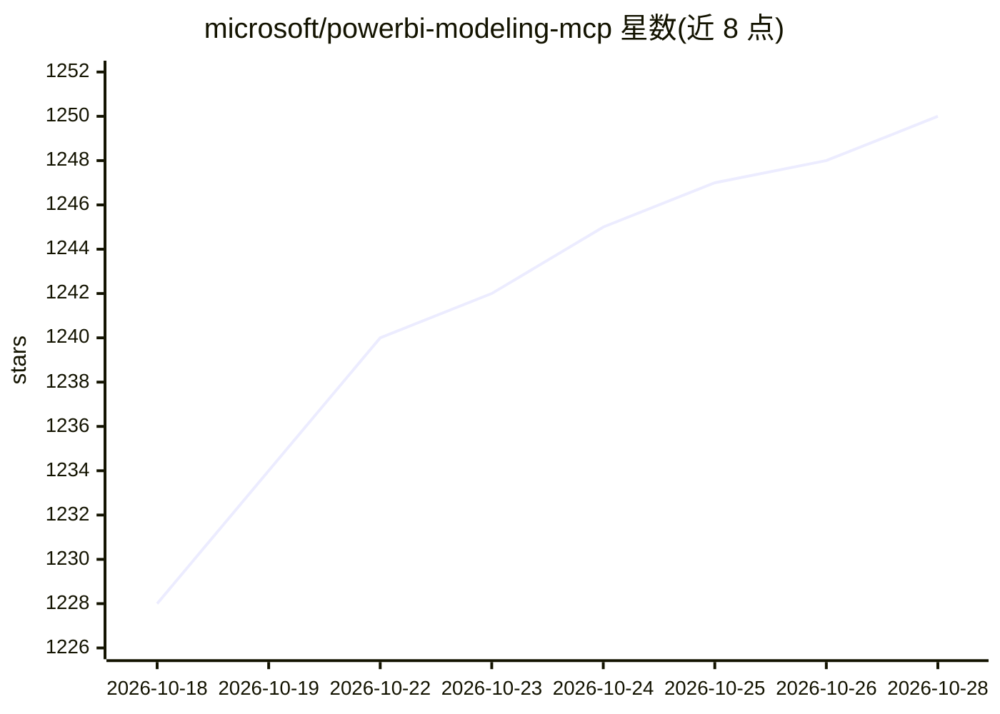

# microsoft/powerbi-modeling-mcp

⭐ 1,253 · MIT · 推送 2026-09-29 · [GitHub](https://github.com/microsoft/powerbi-modeling-mcp) · 组织维护

**让 AI agent 通过 MCP 管理 Power BI 语义模型的本地服务器**

微软开发的本地 MCP 服务器，实现 MCP 规范，把 Power BI 语义建模能力接入 AI agent：连接 Power BI Desktop、Fabric 工作区或 PBIP 文件后，可用自然语言创建/修改表、列、度量值、关系等，支持批量操作、事务控制、DAX 查询执行与验证、模型翻译与文档生成。安装推荐 VS Code 扩展 + GitHub Copilot，也可通过 npx 或手动下载 VSIX 运行 exe。限制：仅能执行建模操作，不能修改报表页等元数据；需先接受 EULA；Fabric 场景另有微软托管的远程版本。

## 筛选速览

| 维度 | 判定 | 备注 |
|---|---|---|
| AI 角色 | `ai-ecosystem` | LLM/agent 周边工具 |
| 许可风险 | `permissive` | MIT |
| 部署形态 | `desktop` | 安装包/桌面程序 |
| 模型依赖 | — | README 未给出锁定关系 |
| 硬件要求 | — | 无带数字的原话,不猜 |
| 安装摩擦 | `low` | 无编译、无系统依赖或容器化 |
| 成熟度 | — | 结构信号不足 |

## 能力要点

- 自然语言驱动语义模型建模：表/列/度量值/关系/计算组等 21 类工具操作
- 批量操作含事务支持（begin/commit/rollback）与错误处理
- DAX 查询执行与验证、多模型基准测试
- 支持 Power BI Desktop、Fabric 工作区与 PBIP/TMDL 项目文件三种连接方式

## 适用场景

- 让 AI 助手批量重命名或补全模型描述、生成文档
- 把度量值重构为计算组或用户自定义函数
- 对模型执行并验证 DAX 查询以排查计算问题
- 生成语义模型的法语等多语言翻译

## 场景标签

`数据分析` · 领域:效率与自动化

## 证据(README 行号)

> L6: The **Power BI Authoring MCP Server** implements the MCP specification to create a seamless connection between AI ag
> L8: The **Power BI Authoring MCP Server** brings Power BI semantic modeling capabilities to your AI agents through a **l

## 星数曲线

2026-10-18 1,228 → 2026-10-28 1,250（+22）

---
*卡片 v1 · prompt 1.4 · 生成 2026-10-21 · 置信度 high · 依据 README sha `ae99b3e8dc02` · [字段定义](../../DATASET.md)*
