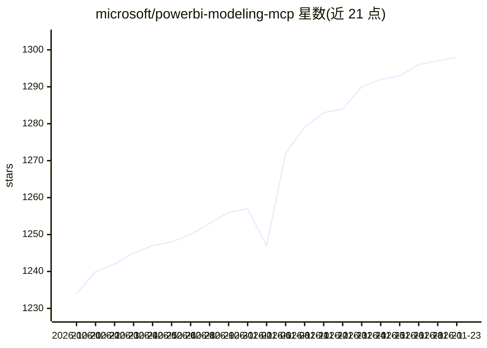

# microsoft/powerbi-modeling-mcp

⭐ 1,298 · MIT · 推送 2026-11-19 · [GitHub](https://github.com/microsoft/powerbi-modeling-mcp) · 组织维护

**让 AI agent 操作 Power BI 语义模型的本地 MCP 服务器**

微软官方的 Power BI Authoring MCP 服务器，实现 MCP 规范，在 AI agent 与 Power BI 语义模型之间建立连接。提供约 21 组工具，覆盖表、列、度量值、关系、计算组、安全角色、分区、翻译等建模对象的创建与管理，并支持 DAX 查询执行与验证、事务控制、TMDL/PBIP 文件操作和 Fabric 部署。通过 VS Code 扩展或任意 MCP 客户端以 NPX/二进制方式运行；不支持 macOS，首次使用需接受 EULA。README 提醒需备份模型以防 LLM 误操作。

## 筛选速览

| 维度 | 判定 | 备注 |
|---|---|---|
| AI 角色 | `ai-ecosystem` | LLM/agent 周边工具 |
| 许可风险 | `permissive` | MIT |
| 部署形态 | `desktop` | 安装包/桌面程序 |
| 模型依赖 | — | README 未给出锁定关系 |
| 硬件要求 | — | 无带数字的原话,不猜 |
| 安装摩擦 | `low` | 无编译、无系统依赖或容器化 |
| 成熟度 | — | 结构信号不足 |

## 能力要点

- 约 21 组 MCP 工具覆盖 Power BI 语义建模全流程（表/列/度量/关系/安全角色/翻译等）
- DAX 查询执行与验证，支持跨模型基准测试
- 支持 TMDL 与 Power BI Project 文件的事务化批量操作
- 提供 VS Code 扩展、NPX 包与二进制下载三种安装方式

## 适用场景

- 用自然语言让 AI 助手批量重命名、重构 Power BI 语义模型对象
- 为模型生成多语言翻译与 Markdown 文档
- 执行并验证 DAX 查询以测试度量值和排查计算问题
- 对数百个对象执行带事务支持的批量建模操作

## 场景标签

 · 领域:BI/数据分析工具链

## 证据(README 行号)

> L7: The **Power BI Authoring MCP Server** implements the MCP specification to create a seamless connection between AI ag
> L9: The **Power BI Authoring MCP Server** brings Power BI semantic modeling capabilities to your AI agents through a **l

## 星数曲线

2026-10-20 1,234 → 2026-11-23 1,298（+64）

---
*卡片 v1 · prompt 1.4 · 生成 2026-11-23 · 置信度 high · 依据 README sha `e910885e3446` · [字段定义](../../DATASET.md)*
