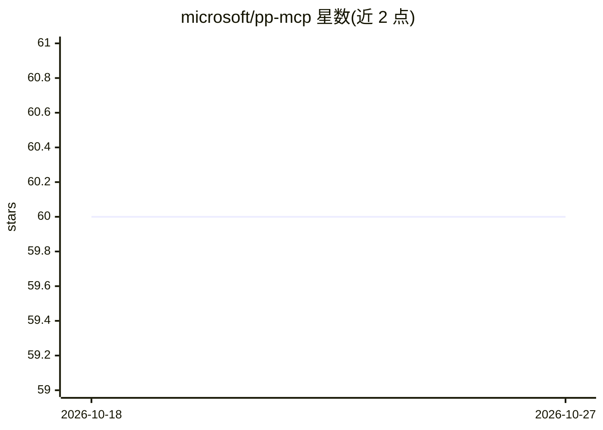

# microsoft/pp-mcp

⭐ 60 · MIT · 推送 2026-10-23 · [GitHub](https://github.com/microsoft/pp-mcp) · [官网](https://aka.ms/pp-mcp) · 组织维护

**微软 Power Platform 的 MCP 实验与示例集合**

微软官方维护的仓库，收录与 Power Platform 配合使用的 MCP（Model Context Protocol）实验项目与示例，L29 提及 Copilot Studio MCP Samples。README 主体为贡献指南（CLA、行为准则、商标条款），未描述具体安装或运行方式，各示例的用法需进入对应子目录查看。面向 Power Platform 与 MCP 集成的开发者。

## 筛选速览

| 维度 | 判定 | 备注 |
|---|---|---|
| AI 角色 | `ai-ecosystem` | LLM/agent 周边工具 |
| 许可风险 | `permissive` | MIT |
| 部署形态 | `None` |  |
| 模型依赖 | — | README 未给出锁定关系 |
| 硬件要求 | — | 无带数字的原话,不猜 |
| 安装摩擦 | `low` | 无编译、无系统依赖或容器化 |
| 成熟度 | — | 结构信号不足 |

## 能力要点

- 收录与 Power Platform 配合的 MCP Labs 与 Samples
- 包含 Copilot Studio MCP 示例
- 微软官方维护并采用 CLA 贡献流程

## 适用场景

- 查找 Power Platform 的 MCP 集成示例代码
- 参考 Power Platform 与 MCP 工具的开发实践

## 场景标签

`工作流自动化` · 领域:效率与自动化

## 证据(README 行号)

> L3: This repository contains MCP Labs & Samples that work with the Power Platform.
> L29: Copilot Studio MCP Samples

## 星数曲线

2026-10-18 60 → 2026-10-27 60（+0）

---
*卡片 v1 · prompt 1.4 · 生成 2026-10-24 · 置信度 low · 依据 README sha `60d1de152a23` · [字段定义](../../DATASET.md)*
