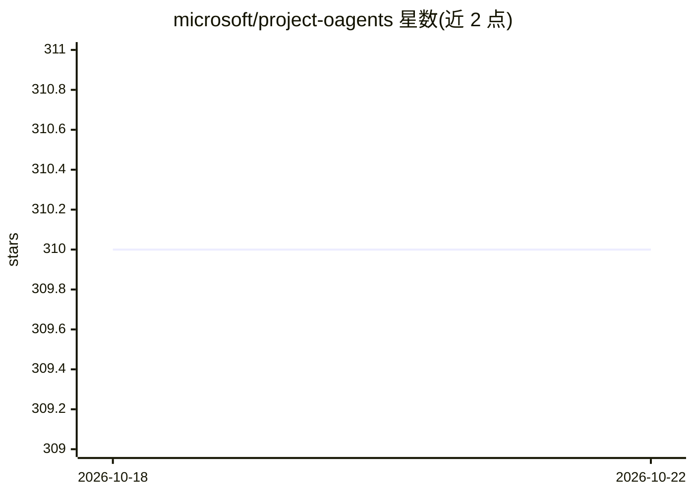

# microsoft/project-oagents

⭐ 310 · C# · CC-BY-4.0 · 推送 2026-08-24 · [GitHub](https://github.com/microsoft/project-oagents) · 组织维护

**构建事件驱动 AI Agent 的 .NET 框架**

Microsoft 维护的实验性 .NET 框架，基于 Semantic Kernel 与 Orleans 构建，用于创建和托管事件驱动的 AI Agent。目前代码仅位于 src/ 目录，计划未来发布为 NuGet 包。提供三个示例：GitHub 开发团队（自动化需求、规划与编码流程）、营销团队（文案/设计/社媒分工协作）、支持中心（基于意图的呼叫中心团队编排）。README 明确声明项目处于实验阶段，不适合生产使用。

## 筛选速览

| 维度 | 判定 | 备注 |
|---|---|---|
| AI 角色 | `ai-ecosystem` | LLM/agent 周边工具 |
| 许可风险 | `viral` | CC-BY-4.0 |
| 部署形态 | `None` |  |
| 模型依赖 | — | README 未给出锁定关系 |
| 硬件要求 | — | 无带数字的原话,不猜 |
| 安装摩擦 | `low` | 无编译、无系统依赖或容器化 |
| 成熟度 | `idea` | |

## 能力要点

- 基于 Semantic Kernel 与 Orleans 的事件驱动 AI Agent 框架
- 提供多 Agent 团队协作示例（开发团队/营销团队/支持中心）
- 计划以 NuGet 包形式发布（当前仅源码位于 src/）

## 适用场景

- 用 .NET 构建多角色协作的事件驱动 AI Agent 团队
- 参考示例搭建自动化开发流程或支持中心编排

## 场景标签

`Agent 框架` `多智能体` · 领域:Agent 开发

## 证据(README 行号)

> L3: # AI Agents Framework
> L5: An opinionated .NET framework, that is built on top of Semantic Kernel and Orleans, which helps creating and hosting

## 星数曲线

2026-10-18 310 → 2026-10-22 310（+0）

---
*卡片 v1 · prompt 1.4 · 生成 2026-10-21 · 置信度 high · 依据 README sha `d43989a99c70` · [字段定义](../../DATASET.md)*
