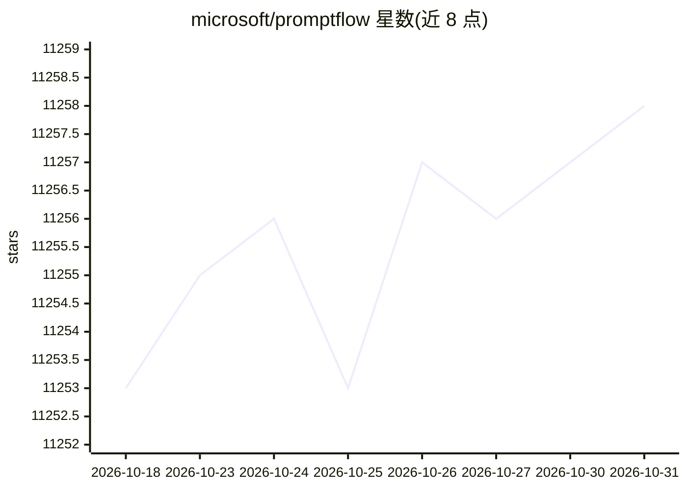

# microsoft/promptflow

⭐ 11,258 · Python · MIT · 推送 2026-10-25 · [GitHub](https://github.com/microsoft/promptflow) · [官网](https://microsoft.github.io/promptflow/) · 组织维护

**微软的 LLM 应用开发工具套件：原型到部署与监控**

微软开源的 LLM 应用开发工具套件（MIT 许可），覆盖从创意、原型、测试、评估到生产部署与监控的端到端流程。核心机制：以可执行 flow 连接 LLM、prompt、Python 代码与工具，提供 CLI（pf 命令）、VS Code 扩展（可视化流设计器）与 Python 包；支持与 OpenAI/Azure OpenAI 建立连接、批量测试与评估并可集成 CI/CD。限制：README 顶部声明该产品将于 2027 年 4 月 20 日退役，不再推荐用于新开发，建议迁移至 Microsoft Agent Framework；容器镜像已停止更新。

## 筛选速览

| 维度 | 判定 | 备注 |
|---|---|---|
| AI 角色 | `ai-ecosystem` | LLM/agent 周边工具 |
| 许可风险 | `permissive` | MIT |
| 部署形态 | `library` | 以包/库形式分发 |
| 模型依赖 | locked-api |  |
| 硬件要求 | — | 无带数字的原话,不猜 |
| 安装摩擦 | `low` | 无编译、无系统依赖或容器化 |
| 成熟度 | — | 结构信号不足 |

## 能力要点

- 以 flow.dag.yaml 连接 LLM、prompt、Python 与工具的可执行流
- CLI（pf flow init/test）与 VS Code 扩展两种开发方式
- 数据集批量评估并可集成 CI/CD
- 支持 OpenAI 与 Azure OpenAI 连接配置

## 适用场景

- 构建并迭代开发 LLM 聊天应用（如 Chat with PDF）
- 对 LLM 应用做批量测试与质量评估
- 将 prompt 应用部署到服务平台的开发流程

## 场景标签

`提示工程` `模型评测` · 领域:Agent 开发

## 证据(README 行号)

> L29: **Prompt flow** is a suite of development tools designed to streamline the end-to-end development cycle of LLM-base
> L34:  - Create executable flows that link LLMs, prompts, Python code and other tools together.

## 星数曲线

2026-10-18 11,253 → 2026-10-31 11,258（+5）

---
*卡片 v1 · prompt 1.4 · 生成 2026-10-20 · 置信度 high · 依据 README sha `7902aaee5961` · [字段定义](../../DATASET.md)*
