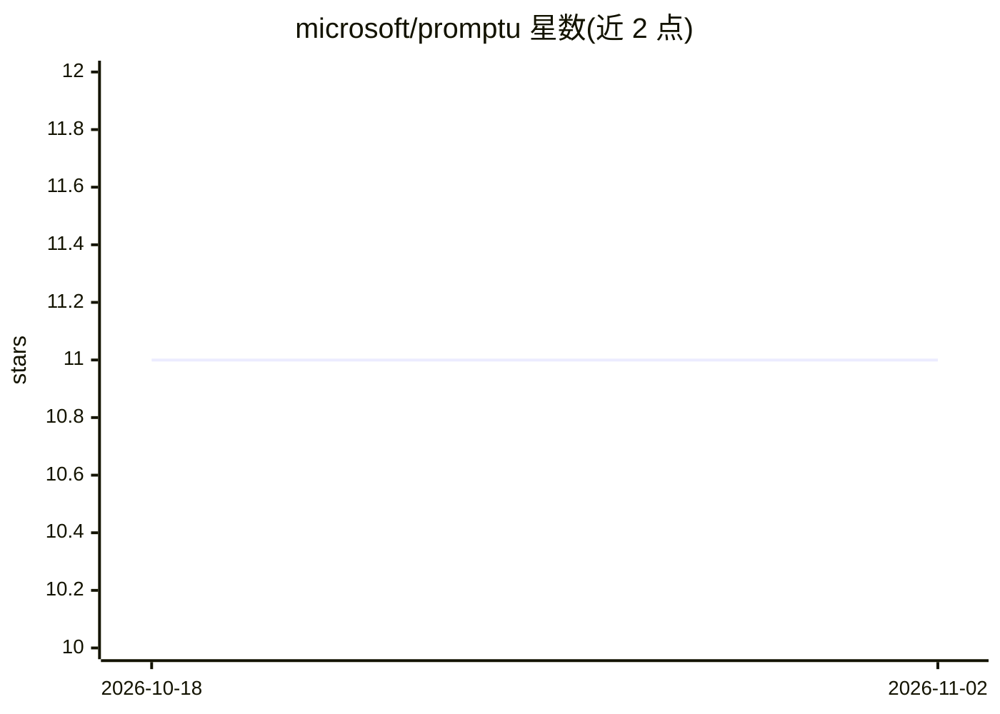

# microsoft/promptu

⭐ 11 · TypeScript · MIT · 推送 2026-09-25 · [GitHub](https://github.com/microsoft/promptu) · 组织维护

**VSCode 扩展：把 AI 提示词变为可分享点击链接并在 Copilot Chat 执行**

微软开源的 VSCode 扩展 promptu：将提示词封装为 vscode:// URI 链接，点击或粘贴到浏览器即可在 VSCode 的 GitHub Copilot Chat（Local 会话）中执行。提示词来源支持 GitHub、Azure DevOps、直接 URL、本地文件、已安装提示词与 MCP 提示词；URI 可附带输入参数、MCP 服务器配置（http/stdio/NuGet）与工作区选择。私有仓库通过 MSAL 或 git 认证访问，需 VSCode 1.109.0+ 与已配置的 Copilot Chat 扩展。

## 筛选速览

| 维度 | 判定 | 备注 |
|---|---|---|
| AI 角色 | `ai-ecosystem` | LLM/agent 周边工具 |
| 许可风险 | `permissive` | MIT |
| 部署形态 | `library` | 以包/库形式分发 |
| 模型依赖 | — | README 未给出锁定关系 |
| 硬件要求 | — | 无带数字的原话,不猜 |
| 安装摩擦 | `low` | 无编译、无系统依赖或容器化 |
| 成熟度 | — | 结构信号不足 |

## 能力要点

- 提示词转为 vscode:// URI 可分享链接，浏览器/快捷键即可触发
- 支持 GitHub/Azure DevOps/URL/本地文件/MCP 六类提示词来源
- URI 中可配置 MCP 服务器（http/stdio/NuGet 包）与工作区选择
- 私有源经 MSAL 或 git 认证自动读取

## 适用场景

- 团队把常用 AI 提示词做成链接，成员一键在 VSCode 中运行
- 在网页、文档中嵌入按钮触发 Copilot Chat 提示词
- 按提示词自动安装并配置所需 MCP 服务器

## 场景标签

`提示工程` · 领域:Agent 开发

## 证据(README 行号)

> L3: Create shareable, clickable links that run AI prompts from anywhere directly in VSCode's Github Copilot Chat.
> L11: - **💬 GitHub Copilot Integration**: Executes prompts directly in Copilot Chat

## 星数曲线

2026-10-18 11 → 2026-11-02 11（+0）

---
*卡片 v1 · prompt 1.4 · 生成 2026-11-02 · 置信度 high · 依据 README sha `d6a9e1452847` · [字段定义](../../DATASET.md)*
