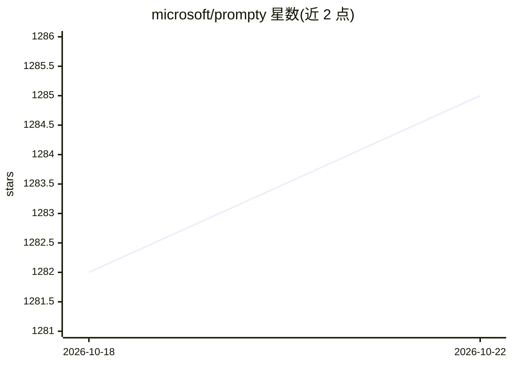

# microsoft/prompty

⭐ 1,285 · Rust · MIT · 推送 2026-10-21 · [GitHub](https://github.com/microsoft/prompty) · [官网](https://prompty.ai) · 组织维护

**面向开发者的跨语言 LLM 提示词文件格式与运行时**

Prompty 定义 .prompty Markdown 文件格式，用于编写、管理与调试 LLM 提示词：文件由 YAML frontmatter（模型配置、输入、工具）与带角色标记和模板语法的正文组成。提示词资产可跨 Python、TypeScript、Rust、C#、Java、Go、Swift 等运行时复用，各运行时通过生成的模型类型与一致性向量保持对齐。支持 OpenAI、Microsoft Foundry、Anthropic 提供方，以及 OpenAI 兼容端点；v2 增加带工具循环、记忆与运行时控制的 agentic turn。另提供 VS Code 扩展（实时预览、连接管理、对话模式、trace 查看器）。MIT 许可。

## 筛选速览

| 维度 | 判定 | 备注 |
|---|---|---|
| AI 角色 | `ai-ecosystem` | LLM/agent 周边工具 |
| 许可风险 | `permissive` | MIT |
| 部署形态 | `library` | 以包/库形式分发 |
| 模型依赖 | — | README 未给出锁定关系 |
| 硬件要求 | — | 无带数字的原话,不猜 |
| 安装摩擦 | `low` | 无编译、无系统依赖或容器化 |
| 成熟度 | `idea` | |

## 能力要点

- 跨 7 种语言运行时共享同一 .prompty 提示词资产
- 支持 OpenAI / Microsoft Foundry / Anthropic 及 OpenAI 兼容端点
- v2 agentic turn：工具循环、记忆、运行时控制（护栏、取消、重试）与 trace
- VS Code 扩展提供实时预览、连接侧栏、对话模式与 trace 查看器

## 适用场景

- 编写一次提示词在多种语言运行时中复用
- 在 VS Code 中直接预览、调试与运行提示词
- 构建带工具调用与记忆的 agent 时保持提示词资产可移植

## 场景标签

`提示工程` · 领域:Agent 开发

## 证据(README 行号)

> L12: Prompty is a **markdown file format** (`.prompty`) for LLM prompts. Write your prompt once — run it from VS Code or
> L153: ## Runtimes
> L161: |Runtime|Packages|

## 星数曲线

2026-10-18 1,282 → 2026-10-22 1,285（+3）

---
*卡片 v1 · prompt 1.4 · 生成 2026-10-21 · 置信度 high · 依据 README sha `8f202e9af814` · [字段定义](../../DATASET.md)*
