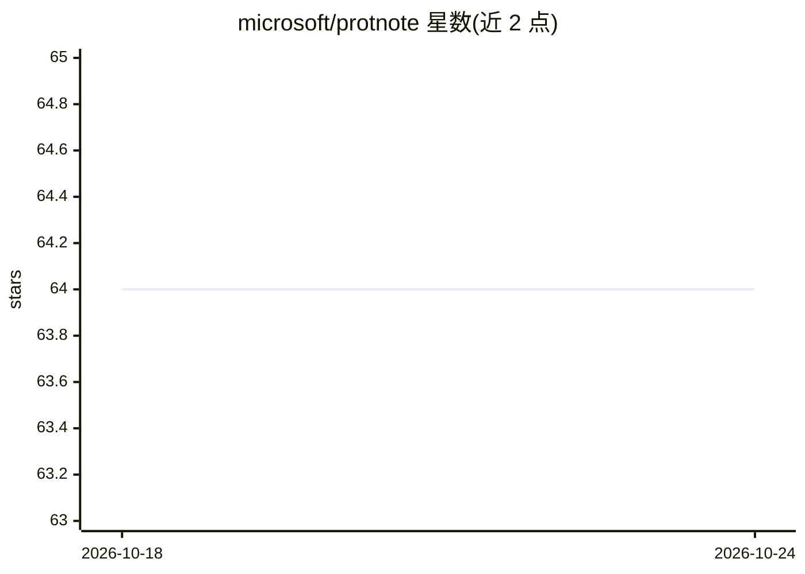

# microsoft/protnote

⭐ 64 · Jupyter Notebook · MIT · 推送 2026-09-14 · [GitHub](https://github.com/microsoft/protnote) · 组织维护

**科研者用自由文本做蛋白质功能预测的多模态深度学习模型**

微软发布的蛋白质功能预测模型：以自由文本描述功能，支持有监督与零样本预测，可泛化到训练集外的 GO 词条与未训练过的 EC 编号注释。训练与测试数据来自 UniProt SwissProt，文本编码默认使用 HuggingFace 的 multilingual-e5-large-instruct，功能描述嵌入预先计算并缓存。以源码仓库形式提供，通过 git clone、conda 环境与 pip install -e 安装，数据（17.6 GB）需从 Zenodo 下载；提供训练与推理脚本及复现论文结果的 notebook。

## 筛选速览

| 维度 | 判定 | 备注 |
|---|---|---|
| AI 角色 | `ai-native` | 本体是模型或模型工具 |
| 许可风险 | `permissive` | MIT |
| 部署形态 | `library` | 以包/库形式分发 |
| 模型依赖 | — | README 未给出锁定关系 |
| 硬件要求 | — | 无带数字的原话,不猜 |
| 安装摩擦 | `low` | 无编译、无系统依赖或容器化 |
| 成熟度 | — | 结构信号不足 |

## 能力要点

- 自由文本输入实现有监督与零样本蛋白质功能预测
- 泛化到未见/新 GO 词条及未训练的 EC 编号注释
- 功能描述文本嵌入预计算并缓存，减少前向计算量
- 提供 5 组不同种子的模型权重与论文结果复现 notebook

## 适用场景

- 为已知少于 1% 人工验证注释的蛋白序列预测功能
- 在预定义标签之外用自由文本探索蛋白质新功能
- 复现论文中零样本功能预测实验结果

## 场景标签

`科研工具` `多模态` · 领域:学习与行业

## 证据(README 行号)

> L8: current models are limited to predicting only those functions on which they were trained. Here, we introduce ProtNot
> L9: a multimodal deep learning model that leverages free-form text to enable both supervised and zero-shot protein funct

## 星数曲线

2026-10-18 64 → 2026-10-24 64（+0）

---
*卡片 v1 · prompt 1.4 · 生成 2026-10-24 · 置信度 high · 依据 README sha `c9a29c67b969` · [字段定义](../../DATASET.md)*
