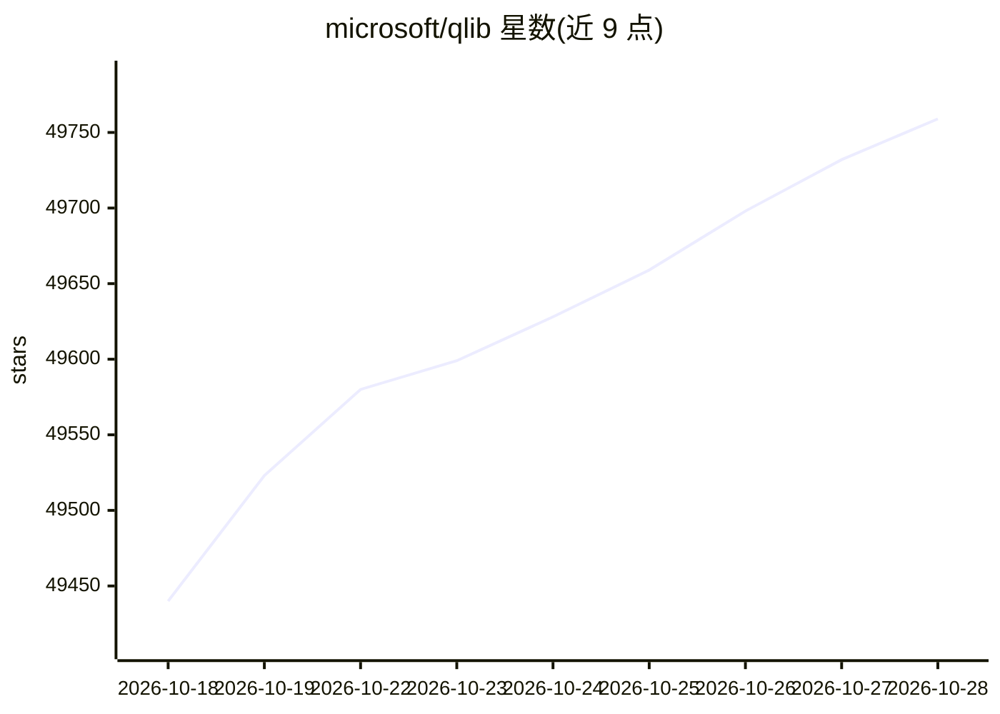

# microsoft/qlib

⭐ 49,782 · Python · MIT · 推送 2026-10-22 · [GitHub](https://github.com/microsoft/qlib) · [官网](https://qlib.readthedocs.io/en/latest/) · 组织维护

**面向量化研究的 AI 量化投资平台**

Qlib 是微软开源的量化投资研究平台，覆盖数据处理、模型训练、回测的完整机器学习流水线，以及 Alpha 挖掘、风险建模、组合优化、订单执行的量化全链条。支持监督学习、市场动态建模（概念漂移适应）与强化学习等多种建模范式，内置多个已发表论文的量化模型。组件采用松耦合设计，可独立使用。安装方面提供 pip 与源码两种途径；官方数据集当前临时禁用，可使用社区数据源或自行从 Yahoo Finance 抓取数据。

## 筛选速览

| 维度 | 判定 | 备注 |
|---|---|---|
| AI 角色 | `ai-ecosystem` | LLM/agent 周边工具 |
| 许可风险 | `permissive` | MIT |
| 部署形态 | `self-host` | docker 或自建部署 |
| 模型依赖 | — | README 未给出锁定关系 |
| 硬件要求 | — | 无带数字的原话,不猜 |
| 安装摩擦 | `low` | 无编译、无系统依赖或容器化 |
| 成熟度 | — | 结构信号不足 |

## 动量与使用信号

- 维护:`active` — 距上次 push 3.5 天,年发版 1,141 位贡献者
- 涨星:近 1 天 **+43**(自 20261016 起算)
- 安装:pypi 包 `pyqlib` 月下载 33,406
- 平台:LINUX · 协议:—

## 能力要点

- 覆盖量化投资全链条：Alpha 挖掘、风险建模、组合优化、订单执行
- 支持监督学习、市场动态建模、强化学习多种 ML 范式
- 内置多个已发表量化模型（论文模型 Zoo）与嵌套交易决策框架
- 提供 RD-Agent（LLM 自动因子挖掘与模型优化）集成

## 适用场景

- 搭建从数据处理到回测的完整量化研究工作流
- 复现和实验已发表的量化论文模型
- 用强化学习建模连续投资决策与交易执行

## 场景标签

`金融量化` `模型训练` · 领域:学习与行业

## 证据(README 行号)

> L92: Qlib is an open-source, AI-oriented quantitative investment platform that aims to realize the potential, empower re
> L96: It contains the full ML pipeline of data processing, model training, back-testing; and covers the entire chain of q
> L173:   pip install pyqlib

## 星数曲线

2026-10-18 49,440 → 2026-10-28 49,759（+319）

---
*卡片 v1 · prompt 1.4 · 生成 2026-10-18 · 置信度 high · 依据 README sha `84b0d91a0720` · [字段定义](../../DATASET.md)*
