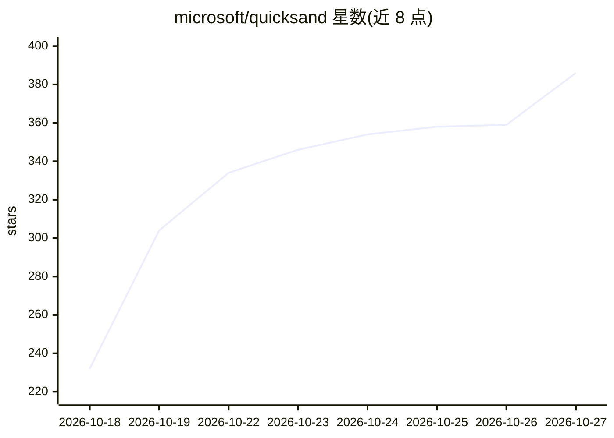

# microsoft/quicksand

⭐ 386 · Python · MIT · 推送 2026-10-26 · [GitHub](https://github.com/microsoft/quicksand) · [官网](https://microsoft.github.io/quicksand/) · 组织维护

**面向 AI agent 沙箱化的 QEMU 虚拟机异步 Python API**

提供启动、控制与快照 QEMU Linux 虚拟机的异步 Python API，聚焦 AI agent 沙箱隔离场景。内置 Ubuntu 与 Alpine 预构建镜像，支持 x86_64/ARM64 跨 macOS/Linux/Windows 运行，无需 root 或 Docker。能力覆盖命令执行、主机目录挂载、网络隔离与双向端口转发、多 Linux 用户、磁盘保存/加载、检查点回滚，以及带 Xfce4 图形环境的桌面镜像控制（截图、键鼠注入）。限制：需安装 QEMU 与镜像组件，沙箱本身为 Linux 虚机。

## 筛选速览

| 维度 | 判定 | 备注 |
|---|---|---|
| AI 角色 | `ai-ecosystem` | LLM/agent 周边工具 |
| 许可风险 | `permissive` | MIT |
| 部署形态 | `library` | 以包/库形式分发 |
| 模型依赖 | — | README 未给出锁定关系 |
| 硬件要求 | — | 无带数字的原话,不猜 |
| 安装摩擦 | `medium` | 含编译或系统依赖之一 |
| 成熟度 | — | 结构信号不足 |

## 能力要点

- 预构建 Ubuntu/Alpine 镜像，无需 root 权限或 Docker
- 检查点回滚与跨机器的磁盘状态保存/加载
- 默认网络隔离，可选 FULL 模式与双向端口转发
- 桌面镜像提供 Xfce4 + 浏览器环境，支持截图与键鼠控制

## 适用场景

- 为 AI agent 提供隔离的执行环境并随时回滚
- 在单个沙箱 VM 内为多个 agent 分配独立 Linux 用户
- 用桌面镜像驱动 agent 操作图形界面与浏览器

## 场景标签

`GUI 自动化` · 领域:效率与自动化

## 证据(README 行号)

> L10: Quicksand is an async Python API to launch, control, and snapshot QEMU virtual machines with a particular focus on 
> L142: |`quicksand-cua`|Overlay (`quicksand-agent`)|~489-500 MB|`quicksand install quicksand-cua`|Agent Sandbox + Xvfb, x

## 星数曲线

2026-10-18 232 → 2026-10-27 386（+154）

---
*卡片 v1 · prompt 1.4 · 生成 2026-10-21 · 置信度 high · 依据 README sha `f7644258783f` · [字段定义](../../DATASET.md)*
