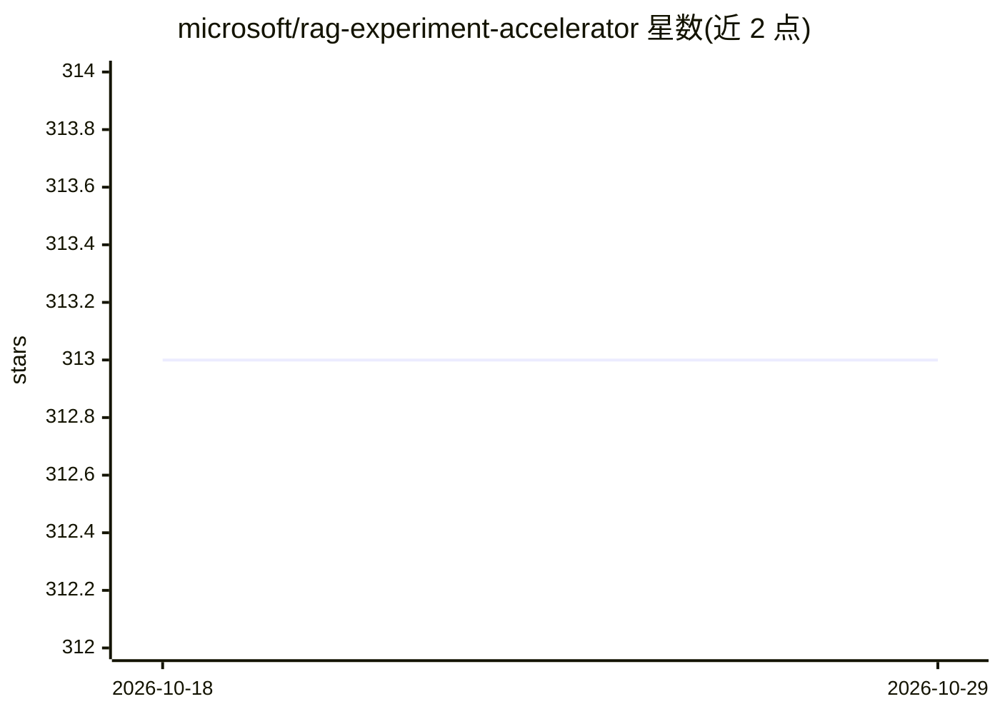

# microsoft/rag-experiment-accelerator

⭐ 313 · Python · NOASSERTION · 推送 2026-06-19 · [GitHub](https://github.com/microsoft/rag-experiment-accelerator) · [官网](https://github.com/microsoft/rag-experiment-accelerator) · 组织维护

**加速基于 Azure AI Search 与 RAG 模式的实验与评测工具**

由微软维护的配置驱动型实验框架：将文档装载（Azure Document Intelligence、LangChain loaders）、Azure AI Search 索引构建（文本/向量/混合/多向量等检索类型）、QA 对生成、查询重排到指标评测（距离/余弦/语义相似度、LLM-as-judge、检索指标 MAP@k）组织为 01–04 四步脚本，并生成含可视化的报告。面向研究人员、数据科学家与开发者，用于搜索与 OpenAI 超参数调优对比；依赖 Azure OpenAI/AI Search/AML 等 Azure 服务，可本地 conda 运行或走 Azure ML pipeline，另提供数据集抽样以加速实验。

## 筛选速览

| 维度 | 判定 | 备注 |
|---|---|---|
| AI 角色 | `ai-ecosystem` | LLM/agent 周边工具 |
| 许可风险 | `none` | NOASSERTION |
| 部署形态 | `library` | 以包/库形式分发 |
| 模型依赖 | locked-api |  |
| 硬件要求 | — | 无带数字的原话,不猜 |
| 安装摩擦 | `low` | 无编译、无系统依赖或容器化 |
| 成熟度 | — | 结构信号不足 |

## 能力要点

- 四步流水线：索引→QA生成→查询重排→评测报告
- 多种检索类型（纯文本/纯向量/混合/多向量）与超参数组合实验
- 端到端指标 + LLM-as-judge 组件指标 + 检索指标（MAP@k）
- 按内容聚类的数据集抽样以加速大规模实验

## 适用场景

- 对比不同检索策略与超参数组合的 RAG 效果
- 批量评测搜索质量与回答质量并生成可视化报告
- 在大数据集上先抽样实验再全量验证

## 场景标签

`RAG` `模型评测` · 领域:评测与运维

## 证据(README 行号)

> L9: The main goal of the **RAG Experiment Accelerator** is to make it easier and faster to run experiments and evaluatio
> L31: 1. **Integration**: It integrates seamlessly with Azure AI Search, Azure Machine Learning, MLFlow and Azure OpenAI.

## 星数曲线

2026-10-18 313 → 2026-10-29 313（+0）

---
*卡片 v1 · prompt 1.4 · 生成 2026-10-21 · 置信度 high · 依据 README sha `bb8ba0c745ab` · [字段定义](../../DATASET.md)*
