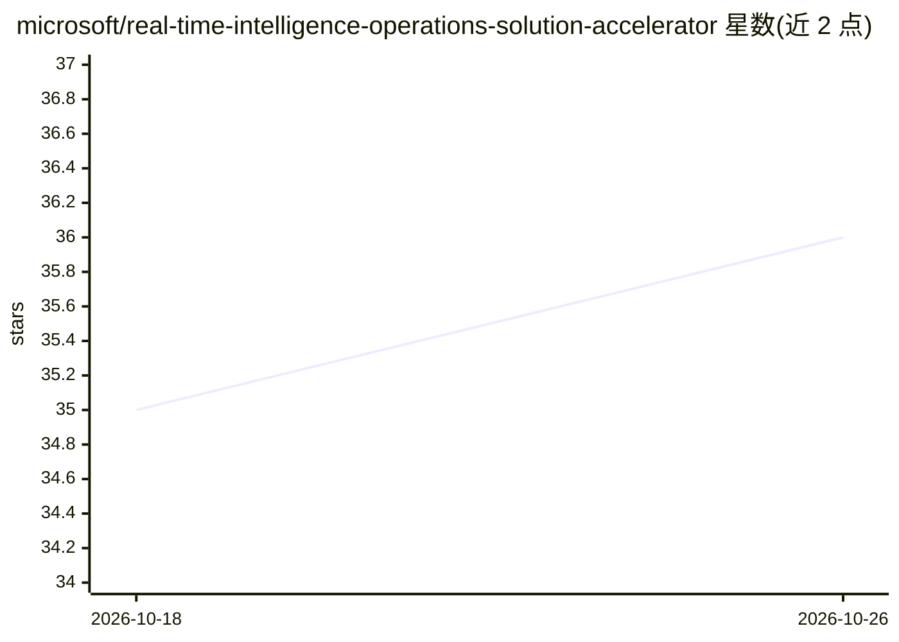

# microsoft/real-time-intelligence-operations-solution-accelerator

⭐ 36 · Python · MIT · 推送 2026-09-21 · [GitHub](https://github.com/microsoft/real-time-intelligence-operations-solution-accelerator) · 组织维护

**制造业实时智能监控方案模板：仪表盘+异常检测+数据 Agent**

微软出品的 Azure/Fabric 方案加速器（azd 模板）：通过遥测数据模拟器生成数据，经 Azure Event Hub 接入 Microsoft Fabric EventHouse，提供实时运营仪表盘（KQL 查询）、由 Fabric Activator 配置的异常检测与邮件/Teams 告警，以及可对话查询运营数据的 Fabric Data Agent。面向制造业监控场景，可替换数据源扩展到其他行业。部署需要 Azure 订阅权限、Microsoft Fabric Capacity，并产生 Azure 与 Fabric 消耗费用。

## 筛选速览

| 维度 | 判定 | 备注 |
|---|---|---|
| AI 角色 | `ai-enhanced` | 去掉 AI 部分产品仍成立 |
| 许可风险 | `permissive` | MIT |
| 部署形态 | `None` |  |
| 模型依赖 | — | README 未给出锁定关系 |
| 硬件要求 | — | 无带数字的原话,不猜 |
| 安装摩擦 | `low` | 无编译、无系统依赖或容器化 |
| 成熟度 | — | 结构信号不足 |

## 能力要点

- Fabric EventHouse 托管遥测数据，KQL 代码可复用
- Fabric Activator 异常检测规则触发 Outlook 邮件或 Teams 通知
- Fabric Data Agent 对话式查询运营数据，无需编程
- 提供批量历史数据与实时遥测数据模拟器

## 适用场景

- 制造工厂经理通过仪表盘分析资产性能与传感器趋势
- 运维团队接收异常自动告警（邮件或 Teams）
- 业务人员用对话方式向数据 Agent 提问获取运营洞察

## 场景标签

`数据分析` · 领域:效率与自动化

## 证据(README 行号)

> L3: This solution accelerator provides a complete real-time intelligence platform for manufacturing operations. It analy
> L51:  - **Fabric EventHouse with Customized Fabric Data Agent**
> L55:  - **Anomaly Detection and Alerts through Fabric Activator** Microsoft Activator is configured with anomaly detecti

## 星数曲线

2026-10-18 35 → 2026-10-26 36（+1）

---
*卡片 v1 · prompt 1.4 · 生成 2026-10-25 · 置信度 mid · 依据 README sha `978fa0641f0f` · [字段定义](../../DATASET.md)*
