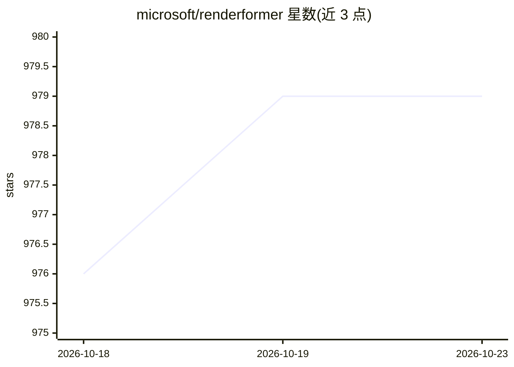

# microsoft/renderformer

⭐ 979 · Python · MIT · 推送 2026-10-13 · [GitHub](https://github.com/microsoft/renderformer) · [官网](https://microsoft.github.io/renderformer/) · 组织维护

**从三角网格直接生成含全局光照渲染图像的神经渲染管线**

SIGGRAPH 2025 论文的官方代码（微软）：RenderFormer 将渲染表述为 sequence-to-sequence 变换，把带反射属性的三角面片 token 序列转换为像素小块 token 序列，分视角无关（面片间光传输）与视角相关两个 transformer 阶段，无需逐场景训练或微调。提供 Hugging Face 预训练模型（205M/483M）、单图与视频推理脚本、Python 批量渲染 Pipeline、JSON 场景格式与 HDF5 转换工具、Blender 参考渲染脚本及 Blender 插件。训练数据范围外推无保证（相机距离、光源数量、三角形数等有建议限制）； specular/自发光仅支持白色。

## 筛选速览

| 维度 | 判定 | 备注 |
|---|---|---|
| AI 角色 | `ai-native` | 本体是模型或模型工具 |
| 许可风险 | `permissive` | MIT |
| 部署形态 | `library` | 以包/库形式分发 |
| 模型依赖 | — | README 未给出锁定关系 |
| 硬件要求 | `gpu-8g` | |
| 安装摩擦 | `medium` | 含编译或系统依赖之一 |
| 成熟度 | — | 结构信号不足 |

## 能力要点

- 三角网格到图像的端到端神经渲染，含镜面反射、软/硬阴影、全局光照
- 无需逐场景训练或微调
- 两阶段 transformer：视角无关光传输 + 视角相关像素生成
- 提供单图/视频推理脚本、批量渲染 Pipeline 与 Blender 工具链

## 适用场景

- 用自己的三角网格场景快速生成带全局光照的渲染图或视频
- 科研复现 SIGGRAPH 2025 论文方法
- 结合 Blender 工作流生成参考图或场景配置

## 场景标签

`图像生成` · 领域:内容生成

## 证据(README 行号)

> L27: RenderFormer is a neural rendering pipeline that directly renders an image from a triangle-based representation of 
> L1: RenderFormer: Transformer-based Neural Rendering of Triangle Meshes with Global Illumination

## 星数曲线

2026-10-18 976 → 2026-10-23 979（+3）

---
*卡片 v1 · prompt 1.4 · 生成 2026-10-21 · 置信度 high · 依据 README sha `2a8b509972d6` · [字段定义](../../DATASET.md)*
