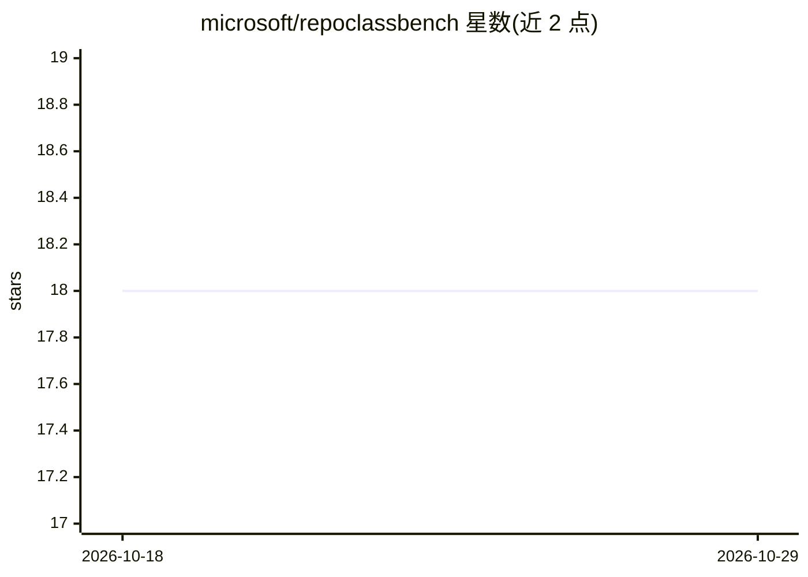

# microsoft/repoclassbench

⭐ 18 · Python · MIT · 推送 2026-10-22 · [GitHub](https://github.com/microsoft/repoclassbench) · [官网](https://arxiv.org/abs/2405.01573) · 组织维护

**仓库级类代码生成基准与 RRR 评测框架（ICML'24 DMLR）**

论文官方代码仓库，包含 RepoClassBench（RCB）与 Retrieve-RepoTools-Reflect（RRR）两部分。RCB 是仓库级类生成基准：287 个任务覆盖 Java(130)/Python(97)/C#(60)，每个任务带跨文件依赖与对应测试用例；RRR 是让 LLM 配合静态分析工具在 agent 设置下迭代推理仓库上下文以生成类代码的框架。仓库提供评测 harness：克隆源仓库、检出 commit、构建测试环境，用 evaluator 对生成代码运行测试并统计通过/编译情况。通过 git clone 源码 + conda 环境 + pip 依赖安装运行。

## 筛选速览

| 维度 | 判定 | 备注 |
|---|---|---|
| AI 角色 | `ai-ecosystem` | LLM/agent 周边工具 |
| 许可风险 | `permissive` | MIT |
| 部署形态 | `library` | 以包/库形式分发 |
| 模型依赖 | — | README 未给出锁定关系 |
| 硬件要求 | — | 无带数字的原话,不猜 |
| 安装摩擦 | `low` | 无编译、无系统依赖或容器化 |
| 成熟度 | — | 结构信号不足 |

## 能力要点

- RepoClassBench：287 个类生成任务，含 Java/Python/C# 三语言
- 任务含跨文件依赖与验证用测试用例
- RRR 框架：LLM + 静态分析工具的 agent 迭代推理
- 提供 evaluator 运行测试并输出通过/失败/编译结果

## 适用场景

- 评测代码生成模型或方法在类级仓库场景的表现
- 复现论文中 RRR 方法与实验
- 为代码生成研究构建跨文件依赖的测试任务

## 场景标签

`代码生成` `模型评测` · 领域:编码与开发

## 证据(README 行号)

> L6: 1. **RepoClassBench (RCB)**: A repository-level code-generation benchmark
> L7: 2. **Retrieve-RepoTools-Reflect (RRR)**: A framework for code generation using Language Models (LLMs) with static-an

## 星数曲线

2026-10-18 18 → 2026-10-29 18（+0）

---
*卡片 v1 · prompt 1.4 · 生成 2026-10-29 · 置信度 mid · 依据 README sha `6db2789f0236` · [字段定义](../../DATASET.md)*
