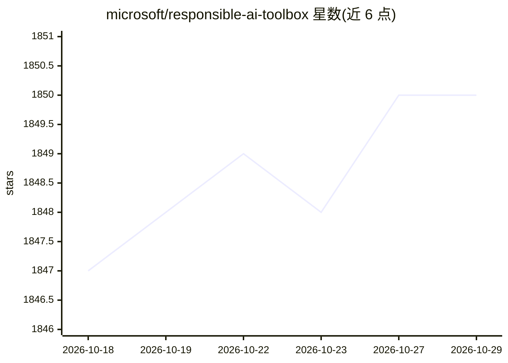

# microsoft/responsible-ai-toolbox

⭐ 1,850 · TypeScript · MIT · 推送 2026-10-26 · [GitHub](https://github.com/microsoft/responsible-ai-toolbox) · [官网](https://responsibleaitoolbox.ai/) · 组织维护

**面向开发者的模型评估调试仪表盘套件：错误分析、公平性、可解释性与因果推断**

微软维护的负责任 AI 工具箱，以可视化组件和 Python 库形式提供模型与数据的探索和评估能力：Responsible AI dashboard 聚合错误分析、公平性评估（Fairlearn）、可解释性（InterpretML）、反事实分析（DiCE）、因果分析（EconML）与数据平衡等组件，支持按工作流自由组合。支持 Scikit 约定模型及 PyTorch/TensorFlow/Keras 训练的模型，也可配合 Azure Cognitive Services 等 API 模型做公平性测试。通过 pip 安装 raiwidgets 使用。

## 筛选速览

| 维度 | 判定 | 备注 |
|---|---|---|
| AI 角色 | `ai-ecosystem` | LLM/agent 周边工具 |
| 许可风险 | `permissive` | MIT |
| 部署形态 | `library` | 以包/库形式分发 |
| 模型依赖 | — | README 未给出锁定关系 |
| 硬件要求 | — | 无带数字的原话,不猜 |
| 安装摩擦 | `low` | 无编译、无系统依赖或容器化 |
| 成熟度 | — | 结构信号不足 |

## 能力要点

- Responsible AI dashboard 聚合错误分析、公平性、可解释性、反事实与因果分析等组件
- 支持 numpy/pandas/scipy 数据格式与 Scikit predict/predict_proba 约定的模型及管道
- 支持 PyTorch、TensorFlow、Keras 深度学习框架训练的模型
- 提供表格、文本、视觉三类 Jupyter notebook 示例

## 适用场景

- 识别模型错误并定位表现不佳的数据子群
- 用组公平性指标审计模型对敏感特征的公平问题
- 通过反事实与因果分析辅助业务决策
- 对 Azure Cognitive Services 等 API 模型做公平性测试

## 场景标签

`模型评测` · 领域:评测与运维

## 证据(README 行号)

> L17: Responsible AI Toolbox is a suite of tools providing a collection of model and data exploration and assessment user
> L25: | Responsible-AI-Toolbox Repository (Here) |This repository contains four visualization widgets for model assessmen

## 星数曲线

2026-10-18 1,847 → 2026-10-29 1,850（+3）

---
*卡片 v1 · prompt 1.4 · 生成 2026-10-21 · 置信度 high · 依据 README sha `15e7d0fe5c03` · [字段定义](../../DATASET.md)*
