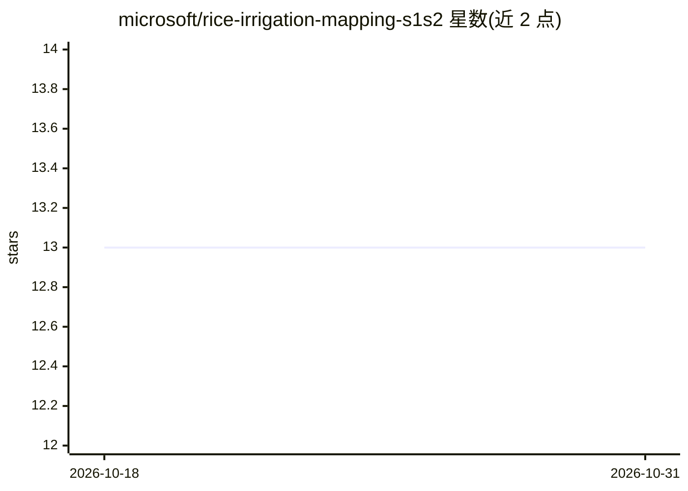

# microsoft/rice-irrigation-mapping-s1s2

⭐ 13 · Python · MIT · 推送 2026-08-26 · [GitHub](https://github.com/microsoft/rice-irrigation-mapping-s1s2) · 组织维护

**用 Sentinel-1/2 时序与 ML 对稻田灌溉与播种方式分类的框架**

面向遥感与农业研究者的训练与推理框架：利用 Sentinel-1/2 卫星时序数据，将稻田按播种方式（DSR/PTR）和灌溉方式（AWD/CF）分类，支持 Random Forest 与 LightGBM 模型，特征包括手工特征、Presto 与 Google Satellite Embeddings。训练数据来自印度旁遮普 PRANA 项目（2024 Kharif 季），迁移到其他区域需作物日历相似。提供复现论文结果的脚本、误差分析与地区级预测对比可视化；自有数据流程需 SNAP 预处理 S1 数据与 Google Earth Engine 账号。

## 筛选速览

| 维度 | 判定 | 备注 |
|---|---|---|
| AI 角色 | `ai-native` | 本体是模型或模型工具 |
| 许可风险 | `permissive` | MIT |
| 部署形态 | `library` | 以包/库形式分发 |
| 模型依赖 | — | README 未给出锁定关系 |
| 硬件要求 | — | 无带数字的原话,不猜 |
| 安装摩擦 | `medium` | 含编译或系统依赖之一 |
| 成熟度 | — | 结构信号不足 |

## 能力要点

- DSR/PTR 播种方式与 AWD/CF 灌溉方式双维度分类
- 支持 Handcrafted/Presto/Google Satellite Embedding 三类特征组合
- 提供训练、误差分析、与政府统计对比可视化的完整脚本
- 含 FTW 流程检测稻田边界的双时相 Sentinel-2 数据

## 适用场景

- 复现论文中旁遮普稻田灌溉/播种分类结果
- 在自己区域的数据上训练稻田管理方式分类模型
- 将地区级模型预测与政府统计估算对比分析

## 场景标签

 · 领域:农业遥感/机器学习

## 证据(README 行号)

> L7: We use Sentinel-1 timeseries to classify rice field irrigation along two dimensions:
> L43: 1. Random Forest (RF)

## 星数曲线

2026-10-18 13 → 2026-10-31 13（+0）

---
*卡片 v1 · prompt 1.4 · 生成 2026-10-31 · 置信度 high · 依据 README sha `1b2079d63e3a` · [字段定义](../../DATASET.md)*
