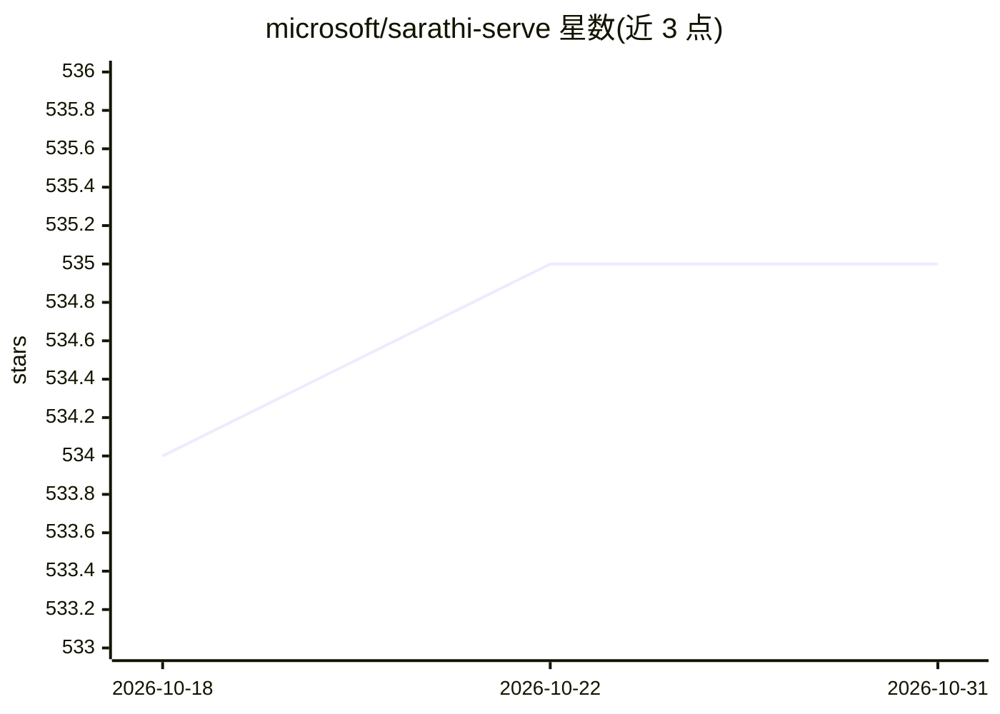

# microsoft/sarathi-serve

⭐ 535 · Python · Apache-2.0 · 推送 2026-01-08 · [GitHub](https://github.com/microsoft/sarathi-serve) · 组织维护

**面向低延迟高吞吐的 LLM 推理服务引擎**

微软开源的 LLM serving 框架，提供吞吐与延迟兼顾的推理服务能力，配套 OSDI'24 论文。安装路径为克隆源码后用 mamba 创建 Python 3.10+ 环境、pip install -e . 从源码安装；需自建 CUDA 环境，README 声明在 H100 与 A100 GPU 上以 CUDA 12.3 测试。仓库内含 osdi-experiments 目录，各子文件夹 README 说明论文各图的复现步骤。未提供打包发行版或 Docker 镜像。

## 筛选速览

| 维度 | 判定 | 备注 |
|---|---|---|
| AI 角色 | `ai-ecosystem` | LLM/agent 周边工具 |
| 许可风险 | `permissive` | Apache-2.0 |
| 部署形态 | `library` | 以包/库形式分发 |
| 模型依赖 | — | README 未给出锁定关系 |
| 硬件要求 | — | 无带数字的原话,不猜 |
| 安装摩擦 | `medium` | 含编译或系统依赖之一 |
| 成熟度 | — | 结构信号不足 |

## 能力要点

- LLM serving 推理服务框架，附 OSDI'24 论文
- 源码安装：mamba 环境 + pip install -e .
- 在 H100/A100 GPU 上以 CUDA 12.3 测试
- osdi-experiments 目录提供论文结果复现说明

## 适用场景

- 部署需要兼顾吞吐与延迟的 LLM 推理服务
- 复现 OSDI'24 论文的实验结果
- 作为研究 LLM serving 调度机制的代码基础

## 场景标签

`推理引擎` · 领域:训练与推理

## 证据(README 行号)

> L3: Sarathi-Serve is a high througput and low-latency LLM serving framework. Please refer to our OSDI'24 paper for more 
> L9: Sarathi-Serve has been tested with CUDA 12.3 on H100 and A100 GPUs.

## 星数曲线

2026-10-18 534 → 2026-10-31 535（+1）

---
*卡片 v1 · prompt 1.4 · 生成 2026-10-21 · 置信度 mid · 依据 README sha `b9c2e5d1fbe5` · [字段定义](../../DATASET.md)*
